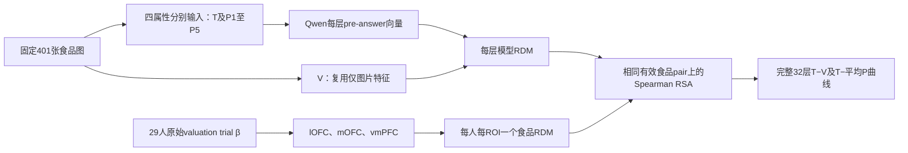

# v07.1：多营养与OFC扩展的实施记录

日期：2026-09-17。承接用户“继续”执行v07扩展方向。历史v07草案、v06.1配置、原始数据和既有kcal/vmPFC结果保留。本页区分已完成结果与正在进行的工作。

## 1. 已完成：493图kcal × 解剖OFC

已完成原版AAL来源/标签核对、模板配准、叠加检查、29人的ROI覆盖与raw β提取，以及A/B全部描述性RSA。

- [结果摘要与完整曲线](../../outputs/20260917_OFC_kcal报告_v02/结果摘要_含逐人分布.md)
- [逐人覆盖（本分享包未收录）](../../SHARING.md#未收录材料)
- [ROI重叠（本分享包未收录）](../../SHARING.md#未收录材料)
- [执行配置](../../configs/ofc_rsa_execution_v01.json)

| ROI | Prompt | T−V跨32层均值 | T−平均P跨32层均值 |
|---|---|---:|---:|
| lOFC | A | −0.000937 | −0.000006 |
| lOFC | B | −0.000007 | −0.000290 |
| mOFC | A | +0.000035 | −0.000336 |
| mOFC | B | +0.000304 | −0.000294 |

跨层均值只表示量级，不是主检验或显著性结论。mOFC的T−P在A/B均有28/32层为负；没有出现稳定的正确匹配优势。既有vmPFC结果不被新ROI替换。

### ROI的具体定义与空间

按[Suzuki等，2017](https://www.nature.com/articles/s41593-017-0008-x)补充图S2a使用原AAL标签：

- lOFC：双侧Frontal_Sup_Orb（2111/2112）、Frontal_Mid_Orb（2211/2212）、Frontal_Inf_Orb（2321/2322）。
- mOFC：双侧Frontal_Med_Orb（2611/2612）；不加Rectus。

图谱来自[FieldTrip发布的AAL](https://www.fieldtriptoolbox.org/template/atlas/)，固定提交`eb3f678281c605392623573b67cd2b42cba9ca03`。配准源为SPM canonical single_subj_T1，固定提交`03ac9473cad402407b6472228377c0167fdc54b8`，与图谱同为91×109×91、2 mm网格。目标为TemplateFlow的MNI152NLin2009cAsym res-02，与当前β的97×115×97网格和仿射一致。

用ANTsPy 0.6.3的SyNRA、固定种子20260917、单线程完成模板间配准，独立目标brain mask约束每个阶段的相似度计算；对标签用最近邻插值。[ANTs接口说明](https://antspy.readthedocs.io/en/latest/registration.html)

初次尝试错误地把SPM源T1当作已去颅骨图；在视觉核查中发现后中止，保留失败记录，改用完整源/目标T1与目标脑内相似度mask，最终采用registration_v02。该修正只依据解剖图像，未看ROI RSA结果。不得把初次未完成配准作为科学分析输入。

配准前后脑内T1相关为0.634→0.891；五个轴位、五个冠状位叠加检查通过。这不等于个体解剖精度或功能信号可靠性已经验证。来源、转换、图和哈希见[图谱准备目录（本分享包未收录）](../../SHARING.md#未收录材料)。

### 覆盖、来源与限制

lOFC解剖7,433体素，各人固定6,560–7,081；mOFC解剖1,673体素，各人固定1,431–1,662。每人的有效体素集合为解剖mask与全部既有run分析mask的交集，身份与顺序跨trial固定。29人均可用，左右侧覆盖均已记录。

每ROI使用与原vmPFC相同的13,765条有效valuation trial β；重新读取的原vmPFC体素与历史缓存逐值一致。没有增加平滑、中心化、白化、PCA或新剔除。mOFC与旧vmPFC球重叠58/272体素，lOFC无重叠；全部来自同一批参与者，不是独立重复样本。

扫描结构相关均值：lOFC session/run为0.1604/0.2410，mOFC为0.0787/0.1507。只作QC报告，不自动修改raw RDM。正式推断与敏感性仍未执行。

## 2. 新四属性：401图共同集合

用户确定新增protein、fat、carbohydrate、fibre四个单属性实验。**具体数值错配阈值与401图集合是助手依据元数据选择的实施默认值，不追记为用户明确指定。**已向用户提供401图保守版与466图仅形态限制版的偏好选择；未收到回复时按已说明的保守默认值继续。冻结发生在新模型效应及本批OFC RSA结果读取之前。

| 入口／规则 | 最大共同图数 | 定位 |
|---|---:|---|
| 原kcal主样本 | 493 | 原实验不变 |
| 四属性均有值 | 489 | 去掉纤维缺失134、150、294、306 |
| 同食品形态＋显示值不同 | 466 | 可行性上限；包含极小和过大的差值 |
| 同形态＋本版保守数值范围 | **401** | 当前新四属性执行集 |

401和466分别是在相应规则下求出的共同可行集合，并非声称401必为某次466最优解的子集。没有按行为、脑或模型效应删图。

### 错配规则

四种属性均采用g/100 g，T/P显示两位小数。对目标值t和候选donor值p，定义

\[
q=\frac{|t-p|}{\max(t,p,1\ \mathrm{g}/100\ \mathrm{g})}.
\]

要求同一既有食品形态类别、不同图片、不同显示值，且**0.05≤q≤0.50**。1 g分母下限避免零值附近比例不稳定；零值仍可参与合格错配。

这些阈值是运行前的操作性选择，不是已有文献公认的可信度标准，也没有人类标签可信度验证。只限制形态会产生如39.4 g脂肪配给0.5 g的脆饼、17.47 g纤维配给约1.3 g的三明治等过大差异；本规则去掉这些极端情况及0.01 g的近乎无变化错配。仍保留某些绝对差较小的低含量食品，不能把每张图都描述成强干预。

对四属性同时求最大共同可行集合：每属性每个被选图片都必须恰好有一个合格donor，也恰好被用作一次donor；先最大化图数，再用固定种子20260917打破同图数解之间的平局。每属性独立生成5套一对一置换，精确保留本属性显示数值的整体分布。

| 属性 | 每套图数 | 五套合计 | 绝对差中位数（g/100 g） | 最大差 |
|---|---:|---:|---:|---:|
| Protein | 401 | 2,005 | 1.02 | 13.60 |
| Fat | 401 | 2,005 | 1.64 | 19.40 |
| Carbohydrate | 401 | 2,005 | 3.50 | 36.52 |
| Fibre | 401 | 2,005 | 0.53 | 3.83 |

共同集合保留25/40个候选食品形态组；对应每ROI 11,207条有效脑试次，每人328–401图，29人均保留。完整分布、零值转换、donor重复数、类别损失和逐图排除原因已保存。不是每张图都有5个不同donor；小类别或数值限制可迫使部分donor重复，而且不同donor也可能提供相同显示值。已核对每属性5套整组呈现清单均不同，并另外保存逐图有效数值种数；不能把5套P当作每张图5种独立数值干预。不同属性的错配强度仍不等同，因此本轮不做“哪种营养最强”的确认性排名。

- [401图与错配清单（本分享包未收录）](../../SHARING.md#未收录材料)
- [466图可行性版本（本分享包未收录）](../../SHARING.md#未收录材料)
- [冻结执行配置](../../configs/multi_nutrient_execution_v01.json)

共同集合会偏向具有足够营养数值变化、可合理错配的食品；不能直接推广为全部568图或所有食品类别的结论。实际范围也有变化：碳水上限97→73.52 g/100 g，纤维上限17.467→10.2 g/100 g；纤维零值图从37降至14。完整分布记录于sample_composition.json；这是设计取舍，不是数据缺失填补或生物排除。纤维不是维生素替代品，数据库值不等于人类主观营养信念。

## 3. 模型和分析流程

这里没有模型训练/测试五折：使用固定模型、固定距离和固定RSA，不拟合从向量到voxel的读出。三个session的有效trial共同进入每人的大RDM，session/run只做QC；401图是共同实验刺激范围，不是按session划分的训练集。

每次只加一行，例如`Protein: 12.34 g per 100 g.`，其他字段分别为Fat、Carbohydrate、Fibre。不同时加入kcal或其他营养，不添加参与者/禁食/fMRI背景。原A/B任务措辞、图片处理、模型revision、BF16、thinking关闭和32层pre-answer readout保持。

V提示逐字验证与旧版相同，直接复用旧V特征／RDM在401图上的子矩阵；子集后重新计算RDM间的秩相关。各属性T与P1–P5新增推理：401×4×6=9,624输入/提示，A+B共19,248输入。

缓存身份新增nutrient字段，避免同图同条件的不同营养互相覆盖。小样本接口覆盖每属性最低/最高值图片的T/P1；先A接口、A全量及完整验证，再B接口/B全量。B门槛只有技术正确性，与A效应方向无关。

每套特征对齐lOFC、mOFC和既有vmPFC，不因ROI数增加模型推理。每人的三个ROI和所有属性/条件使用相同401图中的有效pair；脑RDM从已验证的大RDM取相同食品子矩阵，保持原始多体素相关距离。wanting均值RDM和各属性原数据库值绝对差RDM作参考，session/run仅QC。P仍先算各套RSA分数再平均。

接口审计还记录了层类型：第4、8、12、16、20、24、28、32层为full_attention，其他为linear_attention。层号表示模型计算深度，不能直接对应人脑生物处理阶段；本轮不按层类型再分组做新检验。

本轮只做描述性测量；没有新增显著性检验、最大层选择或效果导向的处理。所有正式推断（包括营养×ROI×层×对比的校正范围）仍待另行固定。

## 4. 执行完成与结果入口

- kcal × lOFC/mOFC：A/B描述性RSA已完成。
- 新四属性：A/B接口各16个输入、反序重复16次通过，32层hidden和评分概率逐值相同。两提示各9,624个全量输入及24组矩阵全部核验；每提示2,249个重复输入payload检查逐值一致。
- 本地矩阵每提示72个文件哈希与服务器一致；模型、依赖、图片处理、readout与旧V相同。旧V的401子集RDM在A/B抽查层1/16/32与直接重算逐值一致。
- 每提示完成87张固定脑RDM、768张新营养模型RDM及77,952个神经RSA分数。每提示750次SciPy独立复算最大差1.11e−16；A/B的全部脑RDM与食品索引完全相同。
- [综合解读](../../outputs/20260917_四营养RSA报告_v01/综合解读.md)、[全部曲线与参考RDM](../../outputs/20260917_四营养RSA报告_v01/结果摘要.md)、[完成回执](../../outputs/20260917_四营养RSA报告_v01/completion_receipt.json)。A阶段快照保留，不冒充完整结果。

描述性结果中，蛋白质lOFC/vmPFC、纤维mOFC的T−V和T−P跨层均值在A/B均为正；其余组合有对比不一致或提示敏感。正差值不等于绝对脑相关较强，部分T曲线仍为负。Wanting没有跨提示一致的正确营养特异性提升。全部属性/ROI/层及逐人差值完整保留，不挑“最佳营养”或层。

本阶段已完成；正式推断、置信带、扫描结构敏感性和新食品泛化均未执行。若继续，需先明确完整统计范围，并注明上述描述性结果已经可见。原冻结执行配置保持不变，完成状态由独立回执记录。

只向既有研究室服务器提供图片路径、图片哈希和营养输入元数据；行为评分与个体脑β留在本项目/外置盘。公开模板在服务器完成配准并回收；本地Git管理，不发布或推送数据。
