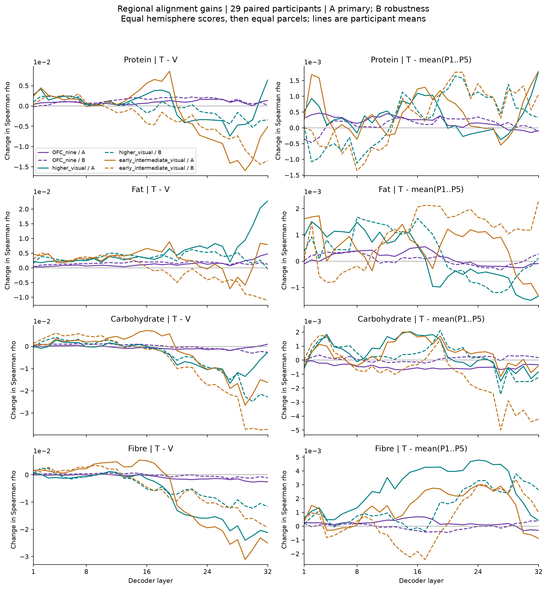
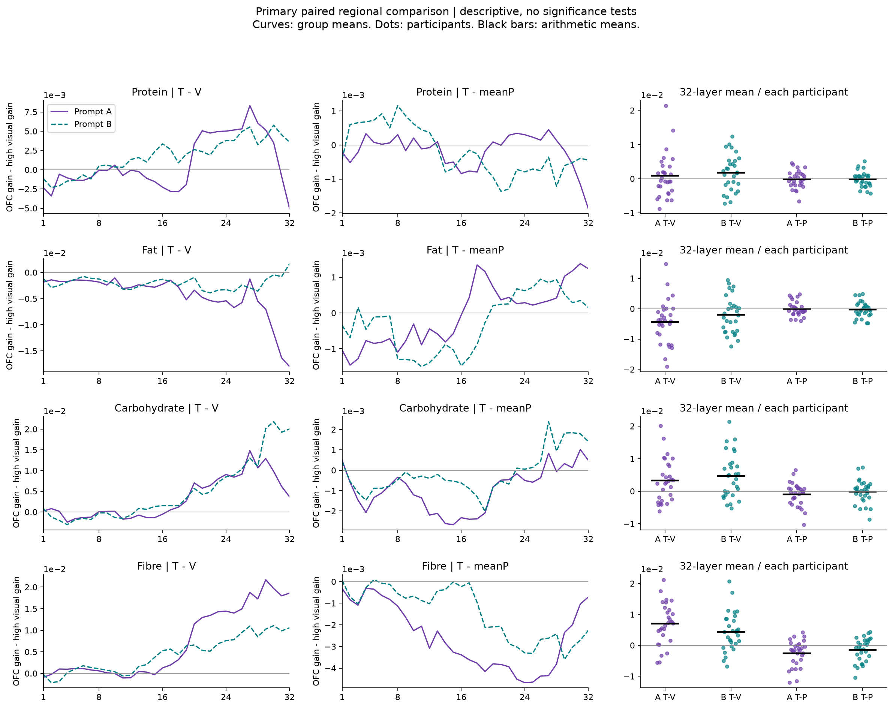
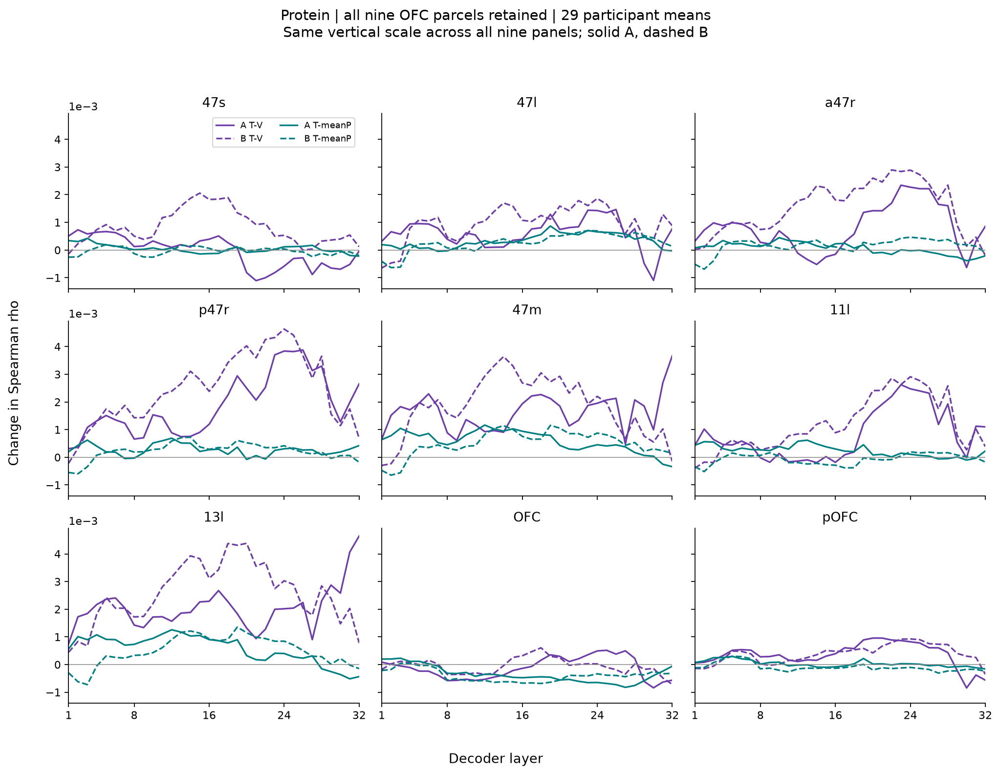
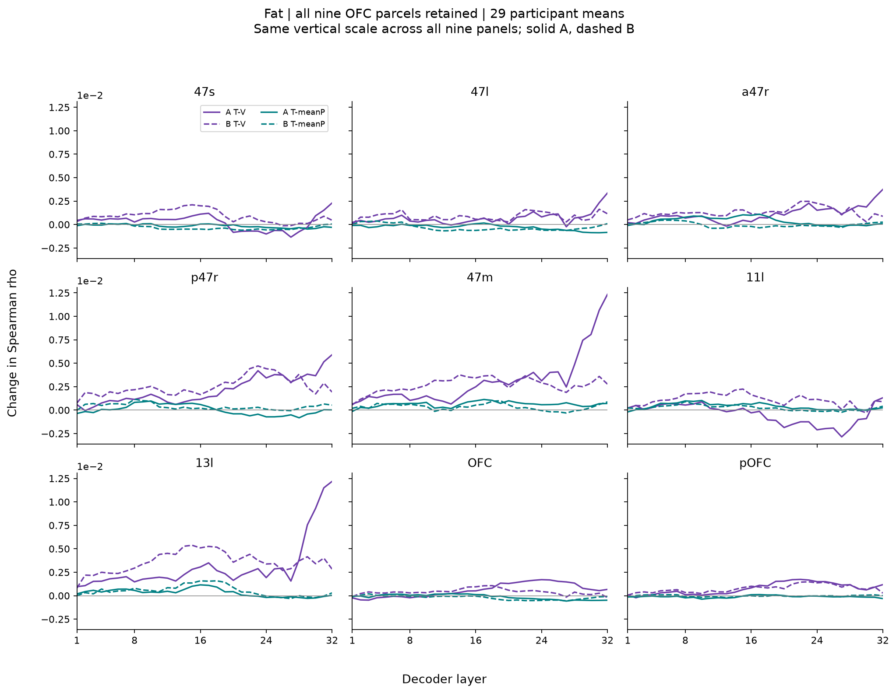
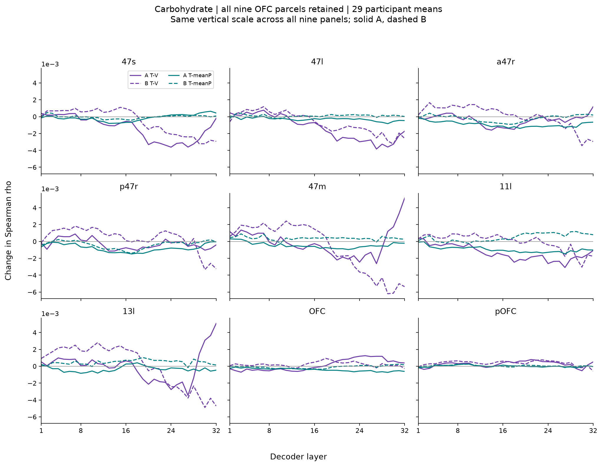
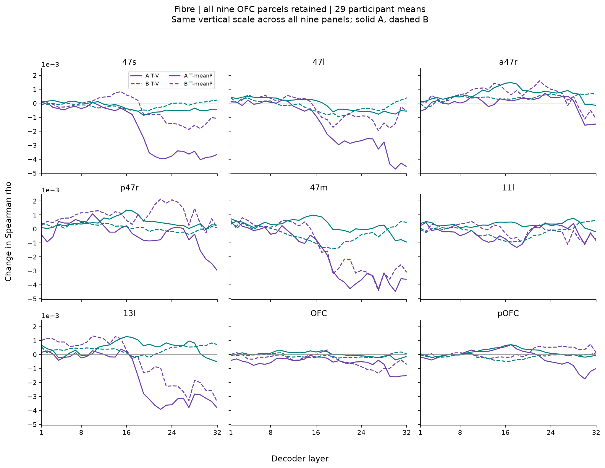
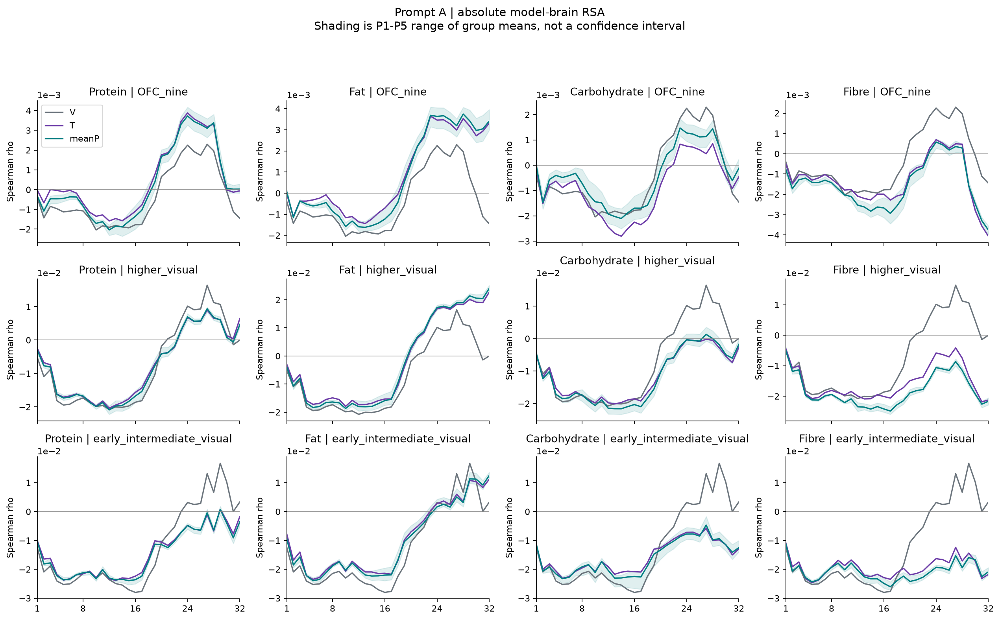
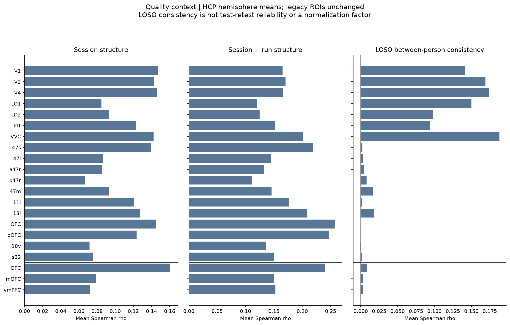
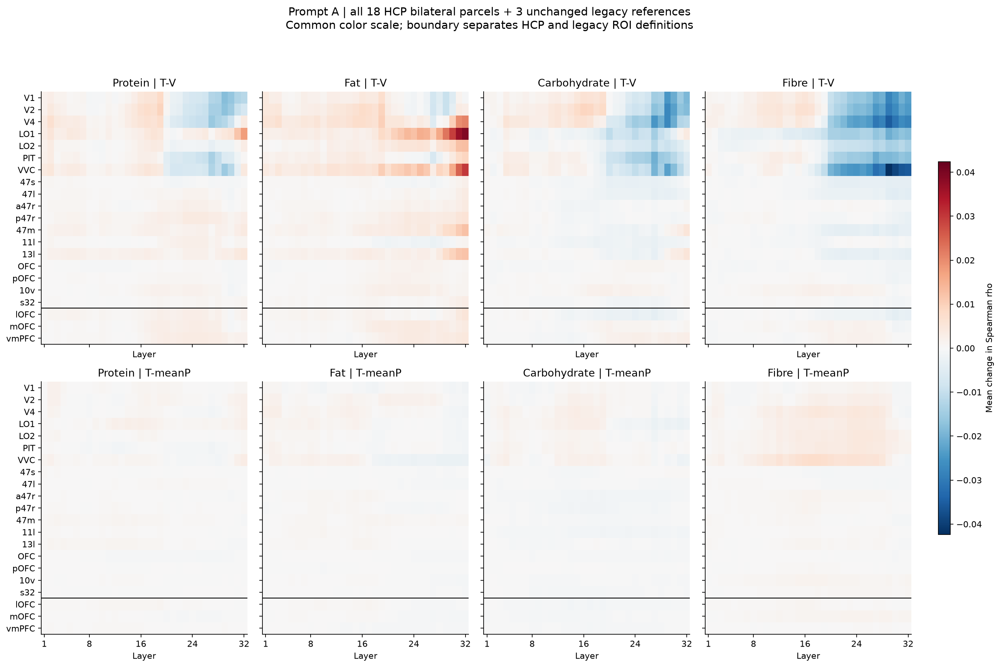

# HCP 区域比较：描述性 RSA 结果

## 结论先看

**18 对 HCP 分区与三个旧 ROI 的四营养 A/B RSA 已全部完成并验证。九个 OFC 分区、各自左右侧以及九区平均均完整保留。**

结果体现营养、区域及模型层的差异，暂不支持“提供正确营养信息就普遍、特异性地增强 OFC 对齐”的统一结论。

- **蛋白质是较值得继续核验的描述性线索**：OFC 九区全层平均 T−V、T−P 在 A/B 都为正；T−V 的 OFC−高阶视觉差也为正。但 T−P 的同一区域差在两套提示的全层平均均为负，因此正确匹配带来的额外优势没有在此摘要上相对偏向 OFC。
- **脂肪**：OFC 自身的两项均值都为正，但高阶视觉的 T−V 更大，不能据此说提升偏向 OFC。
- **碳水和纤维**：OFC 自身全层平均 T−V 在 A/B 都为负。它们的 OFC−高阶视觉 T−V 却为正，原因是高阶视觉下降更多；这属于相对保留，不能称 OFC 净增益。
- 以上全层摘要不替代 32 层曲线。部分区域差值随层改变符号；没有以峰值层或有利层段重新定义主要结果。

本轮无显著性检验、置信区间或总体推广声明。A 为主分析，B 为措辞稳健性检查；已经观察到的正向营养/分区不升级为预注册主假设。

## 1. 样本、方法与保留内容

- 29 人；401 图范围，每人 328–401 张，共 11,207 条有效脑试次/区域。原两条脑试次排除继续保留，没有新增排除或缺失填补。
- HCPex v1.1 作者 2 mm 版本，36 单侧区域分别提取 raw valuation 单试次 β；每人固定体素跨全部可用 run 取交集。原 vmPFC 球、AAL-lOFC、AAL-mOFC 定义不变。
- 脑及模型 RDM 为 1−Pearson；对相同食品配对做 Spearman。实际本轮 36 个新单侧区域与旧三 ROI 的每人 pair mask 完全一致。
- P1–P5 分别算 RSA，再平均分数。单侧 RSA → 左右等权平均 → 分区等权平均 → 参与者内区域差值 → 跨参与者等权平均。
- OFC 摘要为全部九区等权；旧 ROI、10v、s32 不纳入。未合并左右或九区体素来重新建立摘要 RDM。
- Qwen、两套提示、32 层和既有 V/T/P 表征全部复用；没有新模型推理、额外脑预处理或统计检验。

[执行与空间核查](../../docs/research/20260917_HCP执行与核查_v08_1.md) · [冻结执行配置](../../configs/hcp_regional_execution_v01.json) · [数值验证](validation.json)

## 2. OFC 与高阶视觉自身的变化

下面是预先约定的 **32 层等权平均，再对 29 人等权平均**，单位均为 Spearman ρ 的差值。P 指五套 P 的 RSA 分数均值；正数不是显著性标记。

| 营养 / 指标 | A：T−V | B：T−V | A：T−平均P | B：T−平均P |
|---|---:|---:|---:|---:|
| 蛋白质 / OFC 九区 | +0.000887 | +0.001294 | +0.000199 | +0.000115 |
| 蛋白质 / 高阶视觉四区 | +0.000062 | -0.000462 | +0.000374 | +0.000302 |
| 脂肪 / OFC 九区 | +0.001270 | +0.001571 | +0.000113 | +0.000062 |
| 脂肪 / 高阶视觉四区 | +0.005609 | +0.003609 | +0.000157 | +0.000333 |
| 碳水化合物 / OFC 九区 | -0.000502 | -0.000112 | -0.000476 | +0.000089 |
| 碳水化合物 / 高阶视觉四区 | -0.003736 | -0.004820 | +0.000456 | +0.000215 |
| 纤维 / OFC 九区 | -0.000911 | -0.000167 | +0.000213 | -0.000037 |
| 纤维 / 高阶视觉四区 | -0.007916 | -0.004549 | +0.002773 | +0.001404 |

## 3. 直接区域比较

比较的是同一参与者的 **OFC 增益 − 高阶视觉增益**。正值必须结合 OFC 自身的 T−V 判断：视觉下降更大同样能产生正差。

| 营养 / 指标 | A：T−V | B：T−V | A：T−平均P | B：T−平均P |
|---|---:|---:|---:|---:|
| 蛋白质 / OFC−高阶视觉 | +0.000825 | +0.001756 | -0.000175 | -0.000187 |
| 脂肪 / OFC−高阶视觉 | -0.004339 | -0.002037 | -0.000044 | -0.000270 |
| 碳水化合物 / OFC−高阶视觉 | +0.003234 | +0.004708 | -0.000933 | -0.000126 |
| 纤维 / OFC−高阶视觉 | +0.007005 | +0.004382 | -0.002559 | -0.001441 |

四种营养的 **T−P 区域差全层均值在 A/B 均为负**，但这不意味着每层都为负。曲线中存在变号；不能只截取其中有利的层段称为整体特异性。

蛋白质 OFC 自身 T−V 的个人全层均值为正者：A 21/29、B 22/29；OFC−高阶视觉 T−V 为正者：A 14/29、B 18/29。两者并不等价，组均值也掩盖了明显的个体差异。OFC 自身 T−P 为正者 A 14/29、B 15/29；现阶段不能把很小的平均正差称为稳定的人群效应。

次要比较 OFC−早/中间视觉及所有逐人值见 [全部全层摘要](all_layer_summary.csv) 和 [逐人摘要](participant_all_layer_summary.csv)。没有因为次要比较方向更有利而替换主要视觉参照。

## 4. 九个 OFC 分区全部保留

这九区并非表现一致。以蛋白质为例，47l、a47r、p47r、47m、13l 的两项全层均值在 A/B 均为正；名为 **OFC** 的那个具体 HCP 分区两项均值在 A/B 均为负。九区平均不应被当作所有分区共同变化的证据。

### 蛋白质

| 分区 | A：T−V | B：T−V | A：T−平均P | B：T−平均P |
|---|---:|---:|---:|---:|
| 47s | -0.000037 | +0.000817 | +0.000044 | -0.000034 |
| 47l | +0.000610 | +0.000963 | +0.000336 | +0.000262 |
| a47r | +0.000801 | +0.001526 | +0.000064 | +0.000153 |
| p47r | +0.001866 | +0.002449 | +0.000272 | +0.000221 |
| 47m | +0.001649 | +0.001819 | +0.000583 | +0.000498 |
| 11l | +0.000817 | +0.001182 | +0.000242 | -0.000066 |
| 13l | +0.002043 | +0.002566 | +0.000570 | +0.000498 |
| OFC | -0.000125 | -0.000054 | -0.000349 | -0.000400 |
| pOFC | +0.000357 | +0.000380 | +0.000030 | -0.000096 |

### 脂肪

| 分区 | A：T−V | B：T−V | A：T−平均P | B：T−平均P |
|---|---:|---:|---:|---:|
| 47s | +0.000276 | +0.000905 | -0.000157 | -0.000304 |
| 47l | +0.000679 | +0.000843 | -0.000291 | -0.000319 |
| a47r | +0.001101 | +0.001308 | +0.000368 | -0.000022 |
| p47r | +0.002140 | +0.002529 | +0.000018 | +0.000364 |
| 47m | +0.003166 | +0.002682 | +0.000609 | +0.000331 |
| 11l | -0.000429 | +0.001102 | +0.000387 | +0.000234 |
| 13l | +0.003152 | +0.003606 | +0.000319 | +0.000515 |
| OFC | +0.000587 | +0.000418 | -0.000124 | -0.000211 |
| pOFC | +0.000758 | +0.000749 | -0.000110 | -0.000028 |

### 碳水化合物

| 分区 | A：T−V | B：T−V | A：T−平均P | B：T−平均P |
|---|---:|---:|---:|---:|
| 47s | -0.001359 | -0.000562 | -0.000131 | -0.000033 |
| 47l | -0.001310 | -0.000718 | -0.000299 | +0.000097 |
| a47r | -0.000395 | +0.000052 | -0.000920 | -0.000188 |
| p47r | -0.000320 | +0.000355 | -0.000789 | -0.000379 |
| 47m | -0.000133 | -0.000761 | -0.000452 | +0.000381 |
| 11l | -0.001363 | -0.000045 | -0.000959 | +0.000486 |
| 13l | -0.000022 | +0.000076 | -0.000331 | +0.000481 |
| OFC | +0.000143 | +0.000227 | -0.000418 | -0.000089 |
| pOFC | +0.000244 | +0.000369 | +0.000010 | +0.000044 |

### 纤维

| 分区 | A：T−V | B：T−V | A：T−平均P | B：T−平均P |
|---|---:|---:|---:|---:|
| 47s | -0.001812 | -0.000460 | -0.000272 | -0.000159 |
| 47l | -0.001595 | -0.000434 | -0.000094 | -0.000219 |
| a47r | -0.000005 | +0.000551 | +0.000660 | +0.000380 |
| p47r | -0.000361 | +0.000972 | +0.000458 | +0.000102 |
| 47m | -0.001816 | -0.001294 | +0.000221 | -0.000356 |
| 11l | -0.000314 | -0.000132 | +0.000305 | -0.000205 |
| 13l | -0.001516 | -0.000461 | +0.000467 | +0.000358 |
| OFC | -0.000591 | -0.000387 | +0.000022 | -0.000085 |
| pOFC | -0.000187 | +0.000144 | +0.000155 | -0.000146 |

## 5. 绝对对齐值与质量背景

差值变大不等于绝对相关已很高。OFC 的全层平均值接近零；部分营养仍负。完整曲线显示早/中层可能负、部分晚层转正，全层均值不能描述每一层。

| 营养 | 提示 | OFC V | OFC T | OFC 平均P |
|---|---|---:|---:|---:|
| 蛋白质 | A | -0.000411 | +0.000476 | +0.000277 |
| 蛋白质 | B | -0.001099 | +0.000195 | +0.000080 |
| 脂肪 | A | -0.000411 | +0.000859 | +0.000746 |
| 脂肪 | B | -0.001099 | +0.000473 | +0.000410 |
| 碳水化合物 | A | -0.000411 | -0.000912 | -0.000436 |
| 碳水化合物 | B | -0.001099 | -0.001211 | -0.001300 |
| 纤维 | A | -0.000411 | -0.001321 | -0.001535 |
| 纤维 | B | -0.001099 | -0.001266 | -0.001229 |

[B绝对对齐完整曲线](figures/absolute_regional_alignment_B.png)。阴影是五套 P 的组均值范围，不是置信区间。

输入覆盖：36×29 个组合均可计算，固定体素 68–1,674，覆盖中位数 98.96%，最低 67.80%，8/1,044 低于 80%。没有按这个描述性百分比删人，也没有按效应挑选体素。

| 区域摘要 | Session RDM 相关 | Session+run RDM 相关 | 留一被试的组 RDM 一致性 |
|---|---:|---:|---:|
| OFC 九区 | 0.1098 | 0.1827 | 0.0061 |
| 高阶视觉四区 | 0.1108 | 0.1496 | 0.1326 |
| 早/中间视觉三区 | 0.1454 | 0.1673 | 0.1614 |

这些值按同一“单侧→双侧→分区等权”顺序汇总。留一被试的一致性是其脑 RDM 与其他人的可用配对平均 RDM 的相关，**不是重测可靠性，也不是已证明的噪声上限**。视觉区的一致性数值高于 OFC，但本轮没有检验这个差异。

OFC 的组间共同几何较弱，同时存在扫描结构，区域增益不能脱离可测性差异直接解释成功能特异性。个体偏好差异也可能降低跨人一致性；仅凭这个 QC 不能将原因归结为测量噪声。未据此去均值、白化、除以一致性或筛选分区。

## 6. 旧 ROI 与行为证据的连续性

旧 vmPFC 球、AAL-lOFC、AAL-mOFC 在本轮 401 图条件下完整保留。新计算从其旧脑 RDM 重新得到的分数，与已有 A/B 缓存最大误差 2.78×10⁻¹⁷；原结果没有丢失或换定义。

HCP 使用左右单独 RSA 后平均，旧 ROI 保留原双侧体素 pattern 定义；二者并非相同测量。不能把 HCP 九区平均与 AAL-lOFC/mOFC 当作边界相同的区域，也不将两者的一致性称为独立复制。旧 493 图 kcal 保持单独历史分析。

[B全部21套ROI](figures/all_ROI_heatmap_B.png)。每张热图的营养/区域/对比使用统一色阶，较小的 OFC 差值可能不醒目，因此另保留九区细节图；所有图轴均标数值，不用颜色深浅代替效应量。

本轮没有重算既有 human wanting RSA。此前四营养行为锚点未给出跨提示一致的正确匹配优势，仍作为当前叙事边界，见 [原综合解读](../20260917_四营养RSA报告_v01/综合解读.md)。脑侧的新区域比较不能自动填补这一行为证据缺口。

## 7. 当前可以怎么表述

可以说：**在固定的欲望评分任务与表征读出方式下，显式营养输入产生了依赖营养属性、区域与模型层的 model–brain alignment 变化。蛋白质在部分 OFC 分区呈现跨提示同向的描述性改善，视觉参照帮助区分了 OFC 自身增益和视觉对齐下降所造成的相对优势。**

尚不能说：营养普遍提升人类价值表征；提升独属于 OFC；正确匹配效应相对偏向 OFC；模型具有人类食欲；或者人类看到营养标签后脑活动会产生同样变化。人类脑数据未操纵，测量质量、语义加工等替代解释尚未被排除。

若后续决定正式推断或采集结构敏感性，应另行固定范围与新版本，并记录本轮全部曲线已可见；本轮没有自动启用这些分析。

## 8. 输出与核验索引

- [全部21套ROI及5个组摘要的全层数值](all_layer_summary.csv)；[全部32层差值曲线数值](group_contrast_curves.csv)；[绝对对齐与五套P范围](absolute_alignment_curves.csv)。
- [全部单侧、双侧、旧ROI与组摘要的逐人逐层逐条件分数（本分享包未收录）](../../SHARING.md#未收录材料)，共3,222,016行，包括共享V的按营养重复索引；压缩只影响存储，不舍弃记录。
- 单侧、双侧、分区、旧ROI与组摘要的完整分数及区域配对差值亦保存为 NPY 数组，维度定义见 [index.json](index.json)。
- [单侧脑pattern、RDM与试次映射（本分享包未收录）](../../SHARING.md#未收录材料)；[图谱、mask、标签和覆盖（本分享包未收录）](../../SHARING.md#未收录材料)；[逐人逐区QC](acquisition_and_consistency_QC.csv)。
- [RSA输入/输出哈希与依赖审计](audit.json)；[汇总与导出验证](validation.json)；[图表审计](report_audit.json)。

独立距离核对最大误差约8.0×10⁻¹⁵；独立Spearman复核最大误差1.39×10⁻¹⁷；半球、分区、区域差汇总核对最大误差2.78×10⁻¹⁷。所有原始数据、外置盘文件和旧输出保持不变。冻结配置保留运行前状态，完成情况另记回执。
