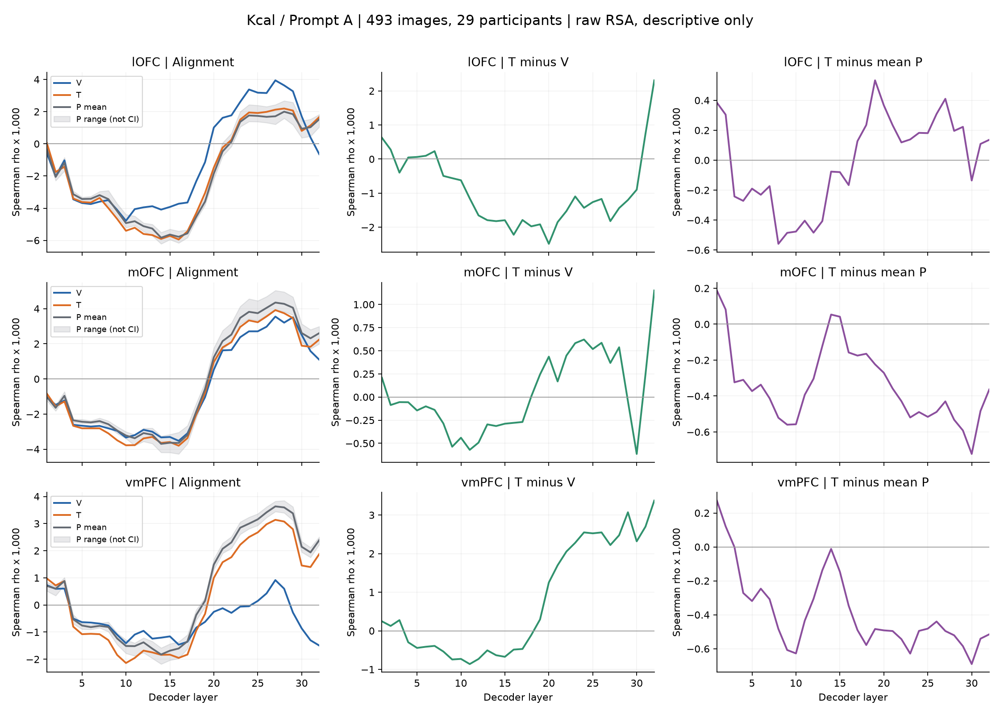
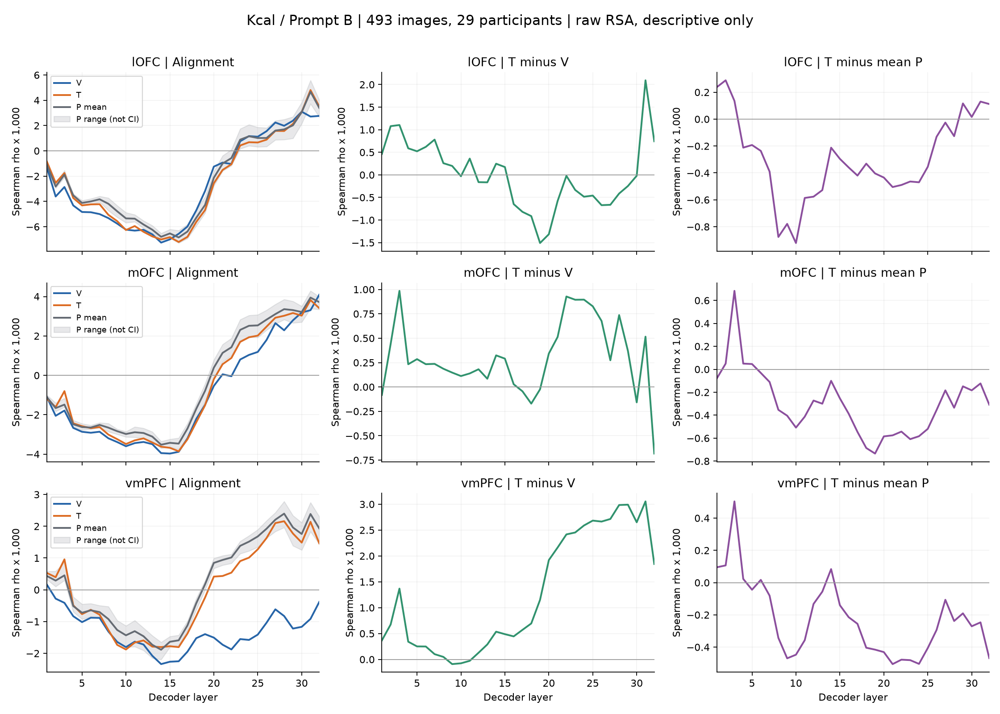
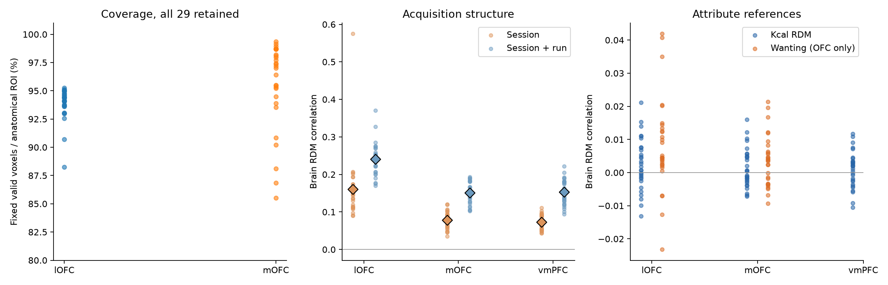

# 原版AAL lOFC/mOFC：kcal RSA结果

日期：2026-09-17。493图、29人，A主要、B稳健性；描述性扩展，未运行推断或敏感性。

## 主要发现

**加入Suzuki定义的解剖OFC区域后，仍未出现正确kcal信息稳定优于错配信息的清晰描述性模式。**mOFC的T−平均P在A/B均为28/32层负；lOFC的该差值随提示和层变化。不要将非显著（本轮根本未检验）写成等效或没有作用。

| ROI | Prompt | T−V跨层均值 | T−平均P跨层均值 | T−P为正的层数 |
|---|---|---:|---:|---:|
| lOFC | A | -0.000937 | -0.000006 | 17/32 |
| lOFC | B | -0.000007 | -0.000290 | 7/32 |
| mOFC | A | +0.000035 | -0.000336 | 4/32 |
| mOFC | B | +0.000304 | -0.000294 | 4/32 |

跨层均值只表示量级，层数不是独立重复或显著性检验。完整逐人分数和32层曲线均保留。

## 区域和数据对应

- 按[Suzuki等原文](https://www.nature.com/articles/s41593-017-0008-x)补充图S2a的标签组合，lOFC取原版AAL双侧Frontal_Sup_Orb、Frontal_Mid_Orb、Frontal_Inf_Orb；mOFC取双侧Frontal_Med_Orb，不加入Rectus。
- 图谱和标签来自[FieldTrip发布的原版AAL](https://www.fieldtriptoolbox.org/template/atlas/)，固定下载提交及哈希。SPM单人T1与AAL具有相同网格；通过有记录的ANTs配准映射到MNI152NLin2009cAsym，用最近邻插值保留标签。不是把不同模板直接当作同一空间。
- 模板叠加检查通过；解剖lOFC为7,433体素，mOFC为1,673体素。每人分别与全部既有run有效mask求交，lOFC固定6,560–7,081体素（88.3%–95.3%），mOFC固定1,431–1,662体素（85.5%–99.3%）。这些是覆盖检查，不等于可靠性已经达标。
- 每ROI保留相同13,765条raw valuation单试次β；既有两条截断trial继续剔除，无新增删人或删trial。重新读取的旧vmPFC体素与历史缓存逐值一致。
- lOFC与旧vmPFC球无重叠；mOFC重叠58/272体素（21.3%）。三ROI来自同一批人、同一批trial，不能当作三份独立复制。

## 计算和QC

每人一个跨session脑RDM，脑与模型用1−Pearson，RDM间用Spearman；P1–P5分别算RSA后取平均。直接复用448个既有kcal模型RDM，无模型重跑。完成58张新脑RDM、25,984个逐人RSA分数；三ROI在每人内使用相同食品pair。

lOFC的session/run RDM相关均值为0.1604/0.2410，mOFC为0.0787/0.1507。采集结构明显，尤其lOFC；目前仅报告，未自动中心化、白化、剔除同run pair或替换raw主分析。它提示解释限制，但不能单凭该数值证明所有模型差异均由扫描结构造成。

Raw kcal RDM与脑相关均值：lOFC 0.00254、mOFC 0.00142；wanting参考分别为0.00842、0.00357。上述同样是描述性数值。

本次新增ROI是在既有vmPFC结果已见后的扩展，非独立确认性复制。新四属性的刺激和P规则已在读取本批OFC RSA结果前保存；不会按这里的正负方向变更ROI、提示或条件。
