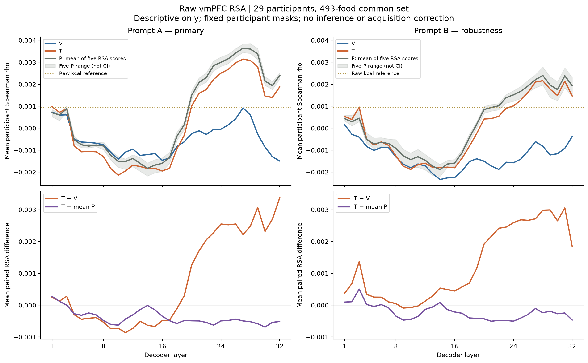
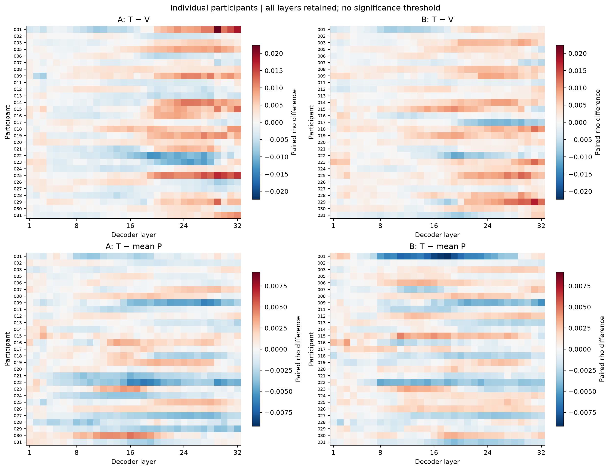
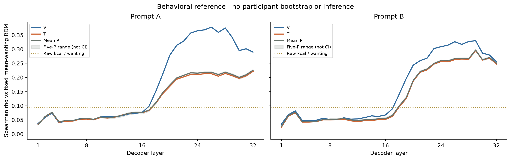
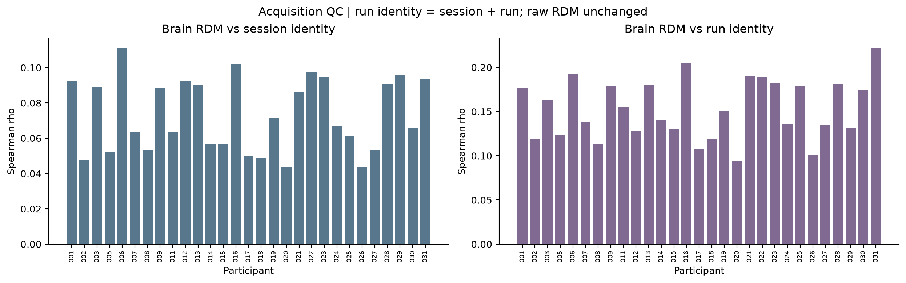

# Raw trial-β RSA首轮描述性结果

日期：2026-09-17。v06.1；已见MSE结果后的follow-up。先A再B，未运行显著性检验、置信带、bootstrap、中心化或pair筛除。

## 当前观察

**计算流程已通过；目前描述性结果没有显示正确营养匹配相对错配的普遍优势。**A/B的晚层中T和P均较V上升，但T−平均P在A的30/32层、B的26/32层为负；不是“T>V且T>P”的整体模式。

神经RSA绝对量级约为10⁻³，逐人方向存在差异；行为wanting在晚层对齐更明显，V高于T/P。脑RDM同时与session/run身份相关，后续解释必须保留这一采集结构限制。这里未做显著性推断，不能断言效应为零，也不能将弱脑相关直接归咎于某一个原因。

## 数据与方法

- 29人、493张共同图片、13,765条脑trial；固定vmPFC支持257–272个体素。保留既有两条脑剔除，无新增筛人/剔除。
- 346个实际SPM来源与历史哈希一致，输入为desc-preproc BOLD；当前LSA脚本与归档相同，无额外空间平滑。该检查不等于所有上游BOLD字节的取证。
- 提取pattern全部finite且非恒定；ROI均值与旧账本逐条完全一致。raw β直接进入1−Pearson RDM，无额外预处理。
- 每人三个session合为大RDM；所有条件、层、A/B共用该人的有效pair。模型/脑RDM下三角Spearman；P先逐套算score再平均，参与者等权。

## 神经结果

**以下跨32层均值只是量级摘要，不是新设主检验；完整曲线及逐人结果均保留。**

| 提示 | V | T | 平均P | T−V | T−平均P |
|---|---:|---:|---:|---:|---:|
| A | -0.000511 | 0.000239 | 0.000624 | +0.000750 | -0.000385 |
| B | -0.001308 | -0.000038 | 0.000186 | +0.001270 | -0.000223 |

| 提示/对比 | 32层群体差值范围 | 群体均值为正的层数 | 跨层平均差值为正的人数 |
|---|---:|---:|---:|
| A / T-V | -0.000861 至 +0.003374 | 17/32 | 17/29 |
| A / T-mean_P | -0.000690 至 +0.000273 | 2/32 | 13/29 |
| B / T-V | -0.000091 至 +0.003055 | 29/32 | 20/29 |
| B / T-mean_P | -0.000505 至 +0.000504 | 6/32 | 14/29 |

正向层数不是独立重复次数，人数计数不是显著性检验。P阴影是五套错配实现的群体分数范围，不是CI。

## 行为与营养参考

| 提示 | Wanting–V | Wanting–T | Wanting–平均P |
|---|---:|---:|---:|
| A | 0.179519 | 0.122466 | 0.125112 |
| B | 0.160821 | 0.135073 | 0.137510 |

以上为跨层描述性均值。Raw kcal对脑RSA的29人均值为0.000953，对wanting为0.093667。Wanting使用单张493图群体均值RDM，不构造29份伪独立样本。

## 采集结构QC

| Identity RDM | 平均ρ | 中位数 | 范围 | 正向人数 |
|---|---:|---:|---:|---:|
| session | 0.073167 | 0.066820 | 0.043580–0.110904 | 29/29 |
| run | 0.152899 | 0.150608 | 0.094292–0.221461 | 29/29 |

Run使用session＋run联合身份。以上表明raw脑RDM含可见的采集结构；不能将其忽略，也不能仅凭这些相关认定模型差异全部来自扫描噪声。本轮按约定只报告，没有触发去均值、白化或pair删除。

## 验证与解释边界

- A/B每人×32层×7条件共12,992个脑RSA分数全部finite。A流程正确性通过后才计算B，未按效果决定。
- 与独立SciPy直接求秩相关核对，每提示84处；最大差A=5.55e-17、B=5.55e-17。
- 模型14组hidden及图片索引重新计算哈希，与既有矩阵审计一致。距离、平局、共同缺失mask、ID重排和P聚合数值验证通过。
- 输入来源、pattern有限值与数值正确性不等于脑测量可靠性或总体效应已经验证。不能由本轮曲线宣称显著改善、条件等效、新食品泛化或模型/人的营养因果机制。
- 这套脑数据没有每人同图独立重复；扫描结构及单次估计噪声仍限制解释。若后续考虑敏感性或正式推断，须记录当前曲线已可见，不改写raw主结果。

## 文件入口

- [全部逐人分数（本分享包未收录）](../../SHARING.md#未收录材料)、[配对差值（本分享包未收录）](../../SHARING.md#未收录材料)、[逐层群体与行为曲线（本分享包未收录）](../../SHARING.md#未收录材料)。
- [采集QC明细（本分享包未收录）](../../SHARING.md#未收录材料)、[RSA计算审计（本分享包未收录）](../../SHARING.md#未收录材料)。
- 本目录提供PNG及PDF科学图、summary.json；不包含统计推断或敏感性结果。
