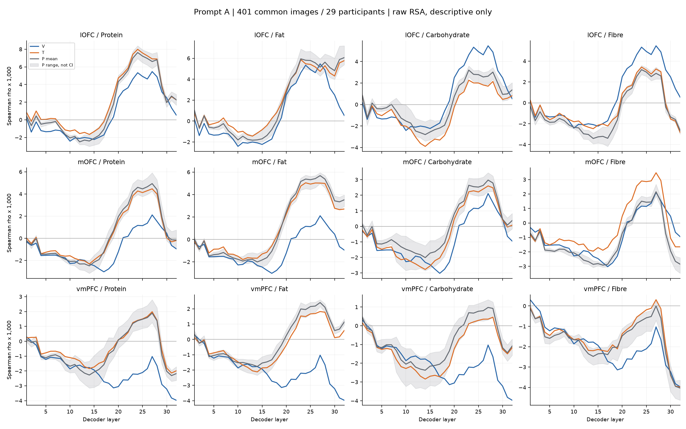
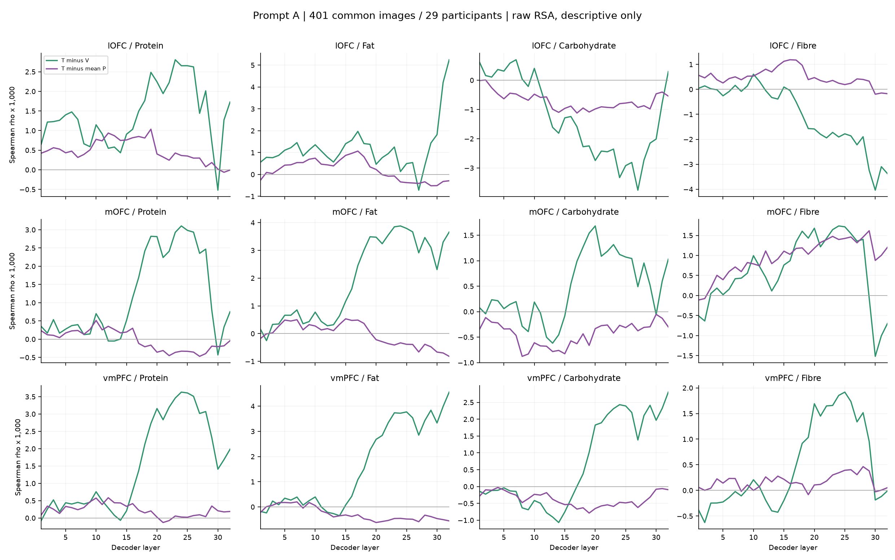
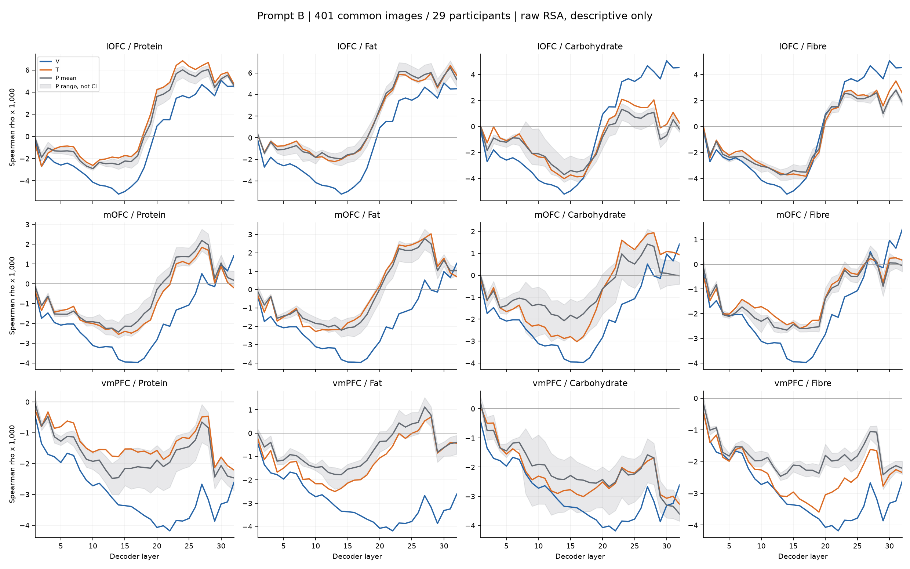
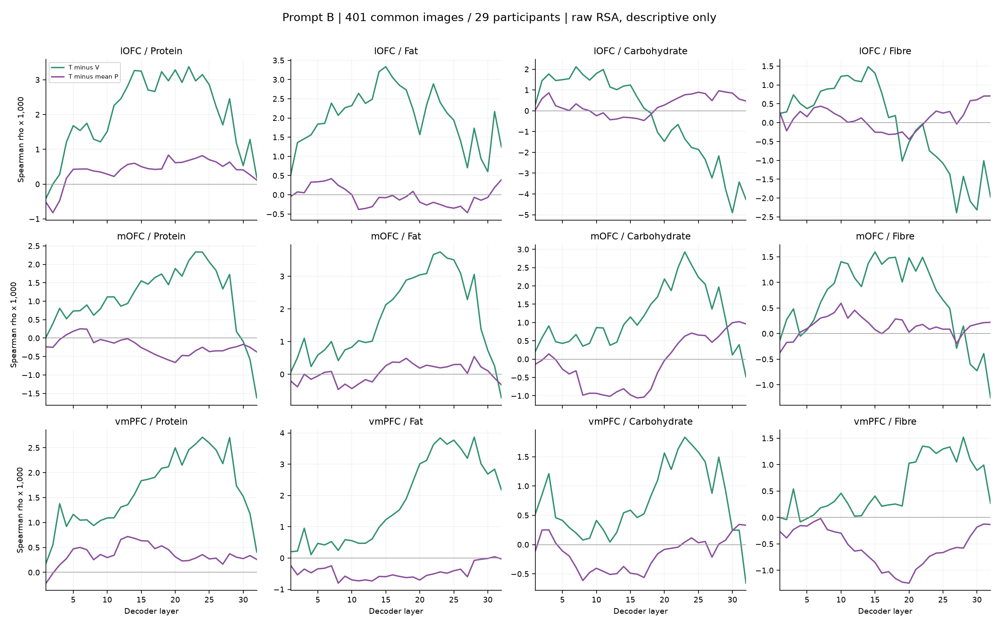
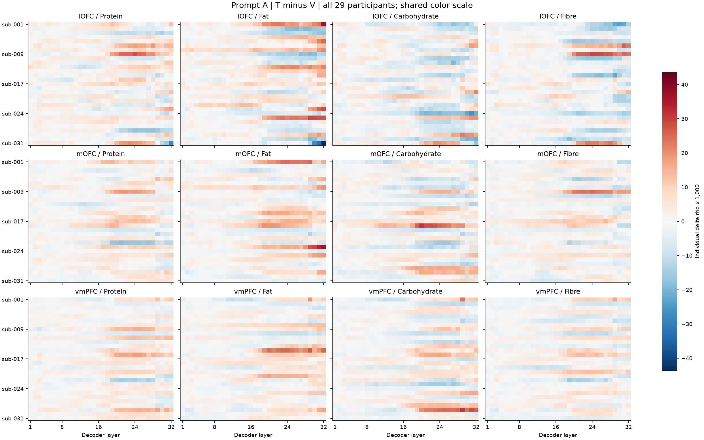
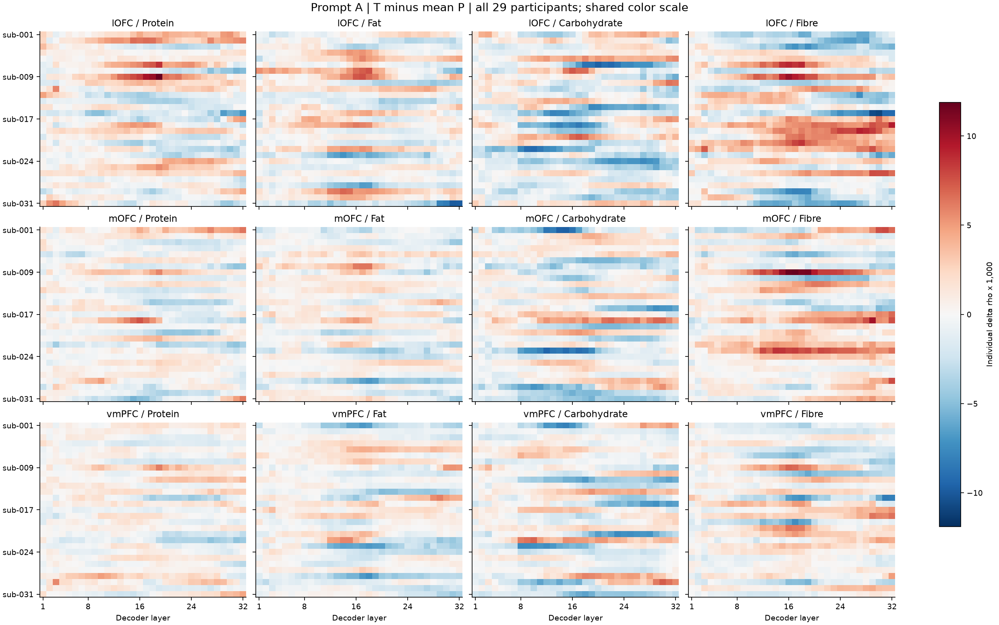
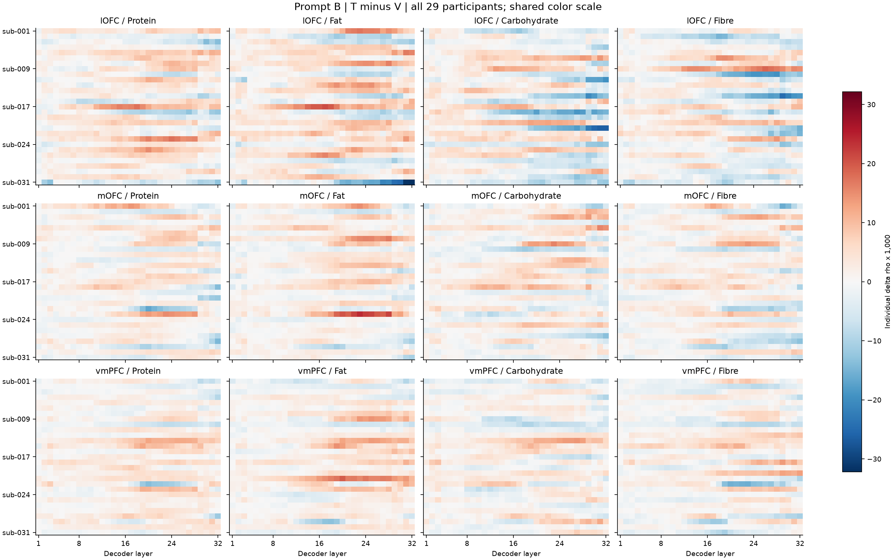
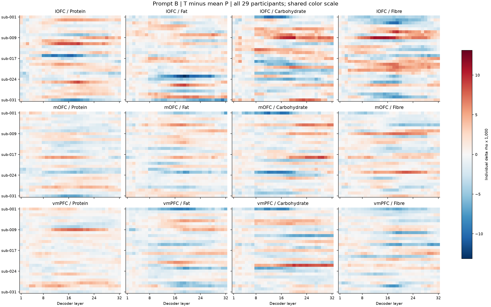
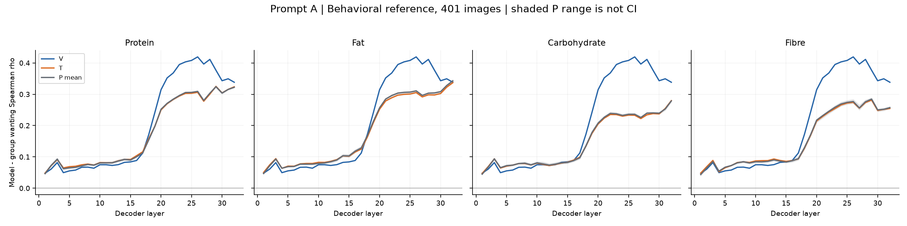
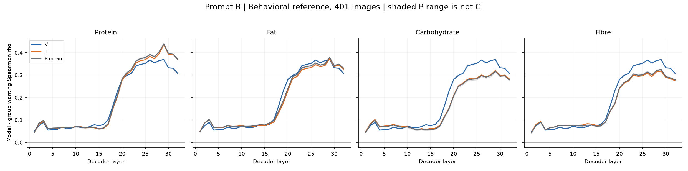

# 四种单营养属性：401图、三个ROI的描述性RSA

日期：2026-09-17。A主要、B稳健性，Qwen3.5-9B、thinking关闭、固定32层pre-answer token。**本报告不包含显著性检验、置信带或最佳层筛选。**

所有条件中的人类脑数据完全相同。这里的变化是模型输入改变后的对齐分数变化，不是人脑看到营养标签后的反应变化。

## 全部结果的量级

下表是跨32层均值，只帮助读数量级，不是新的主检验；必须同时看完整曲线。

| 属性 | ROI | A：T−V | A：T−P | B：T−V | B：T−P |
|---|---|---:|---:|---:|---:|
| Protein | lOFC | +0.001402 | +0.000481 | +0.001995 | +0.000384 |
| Protein | mOFC | +0.001182 | -0.000027 | +0.001058 | -0.000221 |
| Protein | vmPFC | +0.001522 | +0.000227 | +0.001615 | +0.000355 |
| Fat | lOFC | +0.001195 | +0.000190 | +0.002019 | -0.000044 |
| Fat | mOFC | +0.001935 | -0.000036 | +0.001699 | +0.000046 |
| Fat | vmPFC | +0.001618 | -0.000277 | +0.001800 | -0.000452 |
| Carbohydrate | lOFC | -0.001260 | -0.000706 | -0.000338 | +0.000266 |
| Carbohydrate | mOFC | +0.000472 | -0.000436 | +0.001103 | -0.000117 |
| Carbohydrate | vmPFC | +0.000705 | -0.000375 | +0.000726 | -0.000151 |
| Fibre | lOFC | -0.001040 | +0.000482 | -0.000101 | +0.000125 |
| Fibre | mOFC | +0.000618 | +0.000957 | +0.000646 | +0.000144 |
| Fibre | vmPFC | +0.000470 | +0.000168 | +0.000560 | -0.000551 |

## 完整逐层曲线

神经图的纵轴以ρ×1,000显示，每个panel独立缩放。P阴影是5套分数的范围，不是置信区间。三ROI来自同一批参与者，不能把一个区域的正向曲线与另一区域的负向曲线直接当作显著区域差异。

## 逐人差值

全部29人的两种差值都保留；每张图内使用统一色标，无裁切。行顺序对应已保存的subject_id索引。

## Wanting行为锚点

使用401图的人类可用评分均值绝对差RDM，所有模型条件共用。该群体均值RDM不提供29份独立的行为RSA重复。

## 数据、验证和解释边界

- 同一401图、同一参与者有效pair、A/B、三ROI、四属性及全部条件一致。仅V复用旧特征；每种新条件一次只提供一个g/100 g字段。
- 19,248个新增输入均经过缓存身份、模型revision、图片哈希、提示、答案token、32层形状、finite值和评分概率核验。矩阵是BF16输出转float32后的逐值复制。A完成技术验证后才运行B，不看A效应筛B。
- 模型和脑都使用1−Pearson RDM，RDM间Spearman；各P分别算RSA后平均。不把food pairs当独立样本。每ROI保持raw trial β，无新脑预处理、删人或删试次。
- 脑RDM取既有完整RDM的401图有效子矩阵；子集后重新求秩。没有把493图的RSA分数直接挪作401图结果。
- 各营养解释RDM使用原数据库每100 g值的绝对差；提示显示两位小数。Session/run仅作QC，输出保留；没有在看到效果后自动消除采集结构。
- 401图是在既有食品形态类别与保守错配范围下四属性共同可配对的集合，仅覆盖25/40候选形态组。选择只用元数据，但存在食品范围限制，不能直接泛化到全部568图。
- P为同类食品内的一对一数值置换，保留边际分布；数值强度规则是助手运行前的操作性选择，未做人类可信度验证，不是四属性生物效应等强的设计。因此不做“最强营养”的确认性排名。
- 所有新实验沿用同一批已分析的脑数据，且研究者已见过kcal/旧行为结果；这是透明的后续扩展，不是独立盲态复制。mOFC与旧vmPFC存在部分重叠。

正式推断、采集结构敏感性及跨新食品泛化仍未执行。T−V或T−P为正的层数仅是描述，不能替代校正后的participant统计。

## 固定参考RDM与扫描结构

以下均在同一401图范围、同一参与者有效pair上计算，A/B共用。单营养RDM相关低或负，不等于已经否定营养信息与脑表征的关系；模型分数超过该简单参考也不能单独证明复杂整合机制。

| 原始属性RDM | lOFC | mOFC | vmPFC | 群体wanting |
|---|---:|---:|---:|---:|
| Protein | -0.007650 | -0.003310 | -0.002669 | +0.072640 |
| Fat | -0.002494 | -0.000039 | -0.000178 | +0.084805 |
| Carbohydrate | +0.000929 | +0.002744 | +0.000936 | +0.073632 |
| Fibre | -0.007319 | -0.004604 | -0.005449 | +0.106753 |

| 脑ROI | Session相关 | Session＋run相关 | Wanting相关 |
|---|---:|---:|---:|
| lOFC | +0.160729 | +0.240250 | +0.007628 |
| mOFC | +0.078889 | +0.150121 | +0.002714 |
| vmPFC | +0.071809 | +0.152768 | +0.001330 |

## Wanting数量级汇总

跨32层平均仅供阅读数量级，不能替代完整曲线；同一群体wanting RDM不作为29个独立重复。

| 提示 | 属性 | V | T | 平均P |
|---|---|---:|---:|---:|
| A | Protein | 0.203317 | 0.174713 | 0.174323 |
| A | Fat | 0.203317 | 0.177861 | 0.180053 |
| A | Carbohydrate | 0.203317 | 0.146179 | 0.147282 |
| A | Fibre | 0.203317 | 0.155330 | 0.155606 |
| B | Protein | 0.185382 | 0.194640 | 0.198137 |
| B | Fat | 0.185382 | 0.180462 | 0.184553 |
| B | Carbohydrate | 0.185382 | 0.160081 | 0.157560 |
| B | Fibre | 0.185382 | 0.166838 | 0.167809 |

逐人跨层差值的正向人数、中位数和范围见[完整逐人描述](participant_layer_mean_descriptive.csv)。正向人数与正向层数都不构成显著性检验。
