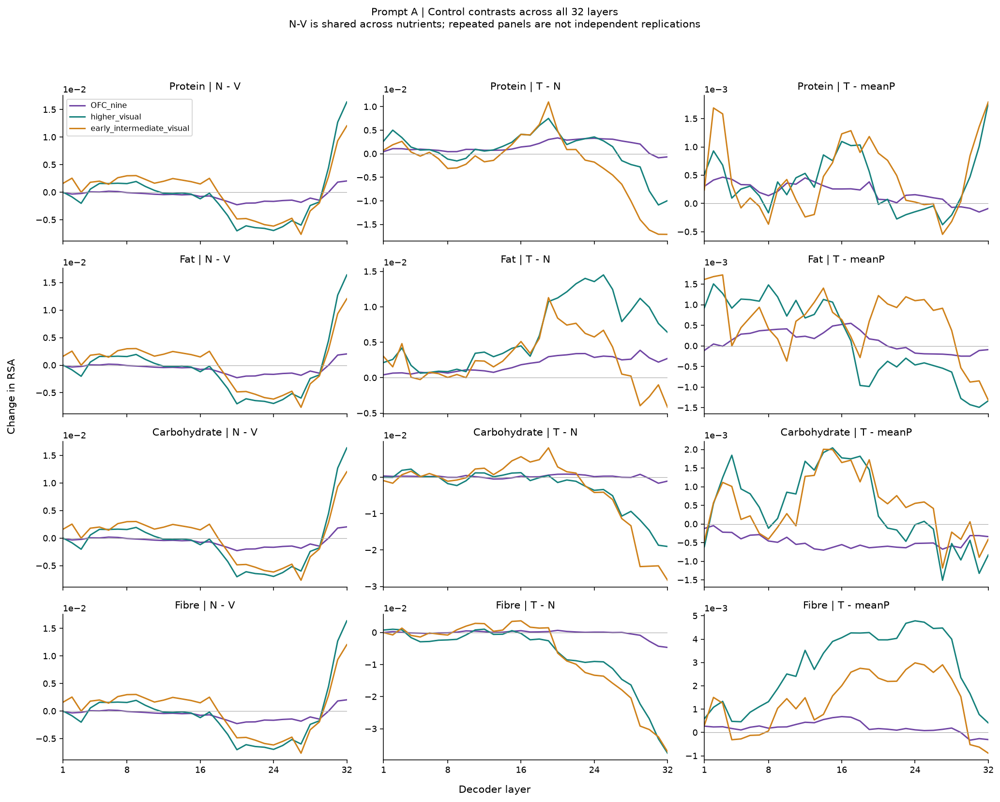
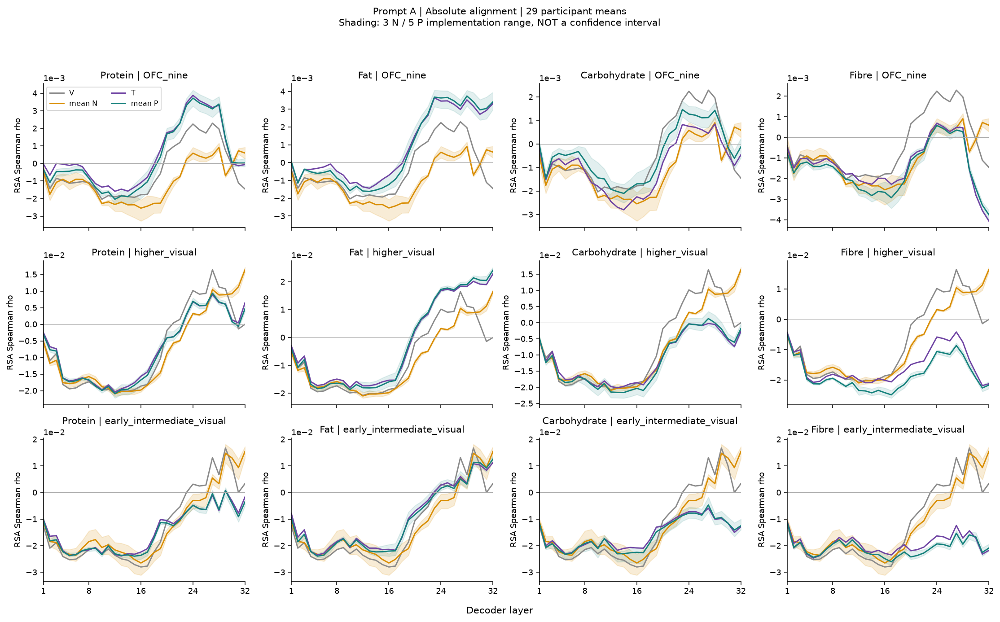
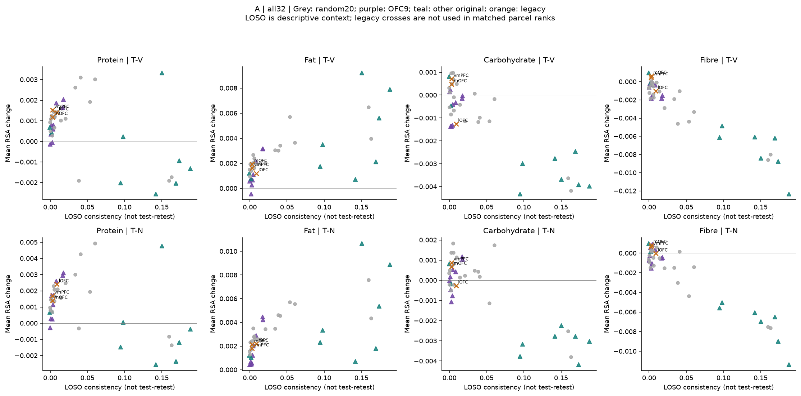
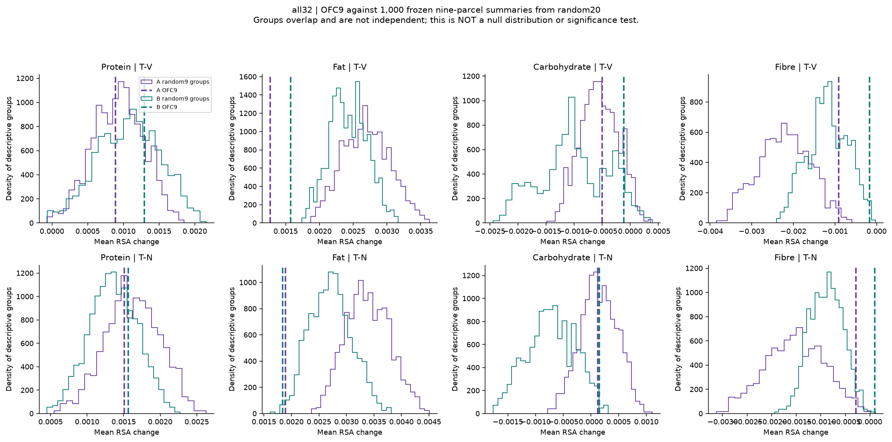
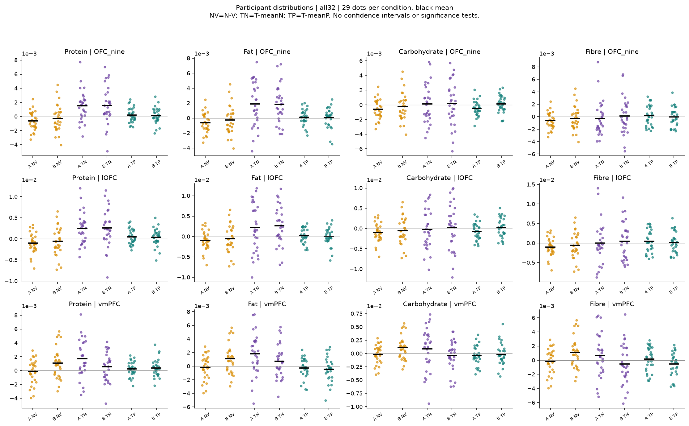

# 无关文本与随机脑区控制：v09 完成报告

日期：2026-09-18。**描述性、已有结果后的控制分析；不报告显著性、置信区间或等效性结论。** A 为主提示，B 为措辞稳健性；L17–32 是看到 v08.1 后选定的探索窗口。

## 主要结论

**新增控制保留了蛋白质／脂肪的一部分结果，但削弱了“OFC特异、正确营养对应驱动”的强故事。**

1. **OFC九区的蛋白质、脂肪结果通过了这次无关文本参照。** A/B全层T−N分别约为蛋白质+0.00151/+0.00156、脂肪+0.00189/+0.00184，且T−V也均为正。分别对N1、N2、N3比较，全层和L17–32窗口均保留正方向；不是仅由某一套N平均出来。这里仍是描述性方向一致，不称显著。
2. **不能扩展成四种营养普遍改善OFC。** 碳水A/B的T−V都为负，尽管T−N略为正；这是相对N下降较少。纤维T−V也均为负，T−N在A/B间变号。
3. **随机脑区控制未建立OFC九区的区域优越性。** 在327个符合冻结可比条件的九区参照中，蛋白质全层T−N低于OFC的组合仅为A19.0%／B51.4%；脂肪为A0.0%／B1.5%。L17–32也没有把蛋白质／脂肪推到参照上端。脂肪对高阶视觉的T−N还大于OFC。因此，OFC有正增益与OFC比其他区域更突出是不同结论。
4. **高排名也不等于提升。** 纤维的OFC全层T−N在参照中位置较高，但A的T−N为负，A/B的T−V均为负；这里主要是其他参照区域下降更多。不能把这个排序改写成价值区增强。
5. **旧vmPFC仍需单独看。** B的无关文本本身使vmPFC对齐增加约0.00108，而A约为−0.00018。蛋白质／脂肪的T−N在两提示仍为正；碳水／纤维的T−N由A正变B负。旧vmPFC和HCP九区并非同一个测量，不能把后者的控制结论直接搬过去。
6. **正确匹配优势没有因新增N而增强。** OFC九区蛋白质／脂肪全层T−P均值仅约0.00006–0.00020；各自五套P的T−P范围均跨越零。它们明显小于T−N，深层脂肪T−P均值还为负。没有检验等效性，但现有描述结果不足以支持“主要由正确营养数值与食物匹配造成”的强解释。

### 当前较稳妥的故事

显式营养文本引起了依赖营养维度、层级和脑区的模型—脑表征对齐变化。蛋白质和脂肪在预先定义的OFC九区摘要中，同时高于图片基线和本次无关物体词参照，方向跨提示与三套文本实现保留；但其区域增益在随机皮层参照中并不普遍突出，正确匹配相对错配的额外优势也较弱且不稳定。

**本轮能排除的范围有限：这批随机物体词并没有复现蛋白质／脂肪在OFC中的正增益。不能据此排除所有提示格式、数字结构或任务相关语义解释。** 如将来继续强化机制，应围绕这些仍未区分的解释另行设计；本轮没有据结果追加实验或筛选新区域。

## 一、完成范围

- 模型：同版本 Qwen3.5-9B，三套无关文本 × 401 图 × A/B，共 **2,406 个新增输入、192 张逐层模型 RDM**。关闭 thinking，BF16，32 层、同一最后 prompt token。
- 脑侧：原18对HCP＋固定抽取20对HCP＋旧vmPFC/AAL-lOFC/AAL-mOFC，最终 **41 套区域结果**，另保留原5组摘要。全部76个HCP单侧及旧3个ROI分数独立保存。
- 新增 **1,160 张脑 RDM**（40单侧×29人），每个ROI为11,207条有效 valuation LSA trial β，个人有效图数328–401。没有新增脑试次或参与者剔除，没有额外脑预处理。
- 旧 V/T/P 分数原值复用；新区域与旧区域逐人食品配对完全一致。3套N与5套P均先各自计算RSA，再平均分数。

## 二、主要结果如何读

以下数值是 RSA 差值 **×1,000**，即表内 `1.000` 对应 Spearman ρ 变化 `0.001`；不是百分比，也不是标准化效应量。均先参与者内平均相应层，再对29人等权平均。

- **T−V**：正确营养相对图片基线的净变化。
- **N−V**：这批无关文本相对图片基线的变化。
- **T−N**：正确营养相对三套无关文本平均的优势。
- **T−P**：正确匹配相对五套错配营养平均的优势。

同一食品配对下，T−V=(N−V)+(T−N)；这只是分数恒等式，**不是因果中介分析**。

### OFC 九区：全32层主摘要

| 营养 | 提示 | T−V | N−V | T−N | T−P |
| --- | --- | --- | --- | --- | --- |
| 蛋白质 | A | +0.887 | -0.622 | +1.509 | +0.199 |
| 蛋白质 | B | +1.294 | -0.267 | +1.562 | +0.115 |
| 脂肪 | A | +1.270 | -0.622 | +1.892 | +0.113 |
| 脂肪 | B | +1.571 | -0.267 | +1.839 | +0.062 |
| 碳水 | A | -0.502 | -0.622 | +0.121 | -0.476 |
| 碳水 | B | -0.112 | -0.267 | +0.155 | +0.089 |
| 纤维 | A | -0.911 | -0.622 | -0.289 | +0.213 |
| 纤维 | B | -0.167 | -0.267 | +0.100 | -0.037 |

### OFC 九区：L17–32探索摘要

| 营养 | 提示 | T−V | N−V | T−N | T−P |
| --- | --- | --- | --- | --- | --- |
| 蛋白质 | A | +1.148 | -1.026 | +2.173 | +0.074 |
| 蛋白质 | B | +1.553 | -1.224 | +2.777 | +0.175 |
| 脂肪 | A | +1.857 | -1.026 | +2.882 | -0.035 |
| 脂肪 | B | +1.689 | -1.224 | +2.913 | -0.054 |
| 碳水 | A | -0.880 | -1.026 | +0.145 | -0.546 |
| 碳水 | B | -1.122 | -1.224 | +0.102 | +0.162 |
| 纤维 | A | -1.709 | -1.026 | -0.684 | +0.098 |
| 纤维 | B | -0.691 | -1.224 | +0.533 | -0.082 |

### 完整层曲线

下图保留全部32层。N在四种营养间共享，因此重复的N−V行不是四次独立重复。绝对分数图中的阴影只是三套N／五套P之间的实现范围，**不是置信区间**。

B图见 [B控制对比](figures/contrasts_B.png)、[B绝对RSA](figures/absolute_B.png)。

## 三、无关文本自身影响了哪些区域？

| 区域 | 全层 A | 全层 B | 深层 A | 深层 B |
| --- | --- | --- | --- | --- |
| OFC_nine | -0.622 | -0.267 | -1.026 | -1.224 |
| higher_visual | -0.692 | -1.206 | -1.719 | -5.765 |
| early_intermediate_visual | +0.195 | -3.993 | -1.620 | -11.160 |
| lOFC | -0.999 | -0.593 | -1.446 | -2.191 |
| mOFC | -0.199 | +0.385 | -0.327 | -0.074 |
| vmPFC | -0.178 | +1.085 | +0.098 | +1.160 |

单位同上。旧3个ROI保持原双侧pattern定义，不能视作与HCP单分区完全相同的测量单位。

## 四、OFC 的变化是否相对高阶视觉更强？

| 营养 | 提示 | 全层Δ(T−V) | 全层Δ(T−N) | 全层Δ(T−P) | 深层Δ(T−V) | 深层Δ(T−N) | 深层Δ(T−P) |
| --- | --- | --- | --- | --- | --- | --- | --- |
| 蛋白质 | A | +0.825 | +0.755 | -0.175 | +2.695 | +2.001 | -0.220 |
| 蛋白质 | B | +1.756 | +0.817 | -0.187 | +3.445 | -1.096 | -0.699 |
| 脂肪 | A | -4.339 | -4.409 | -0.044 | -6.647 | -7.341 | +0.693 |
| 脂肪 | B | -2.037 | -2.976 | -0.270 | -2.148 | -6.689 | +0.274 |
| 碳水 | A | +3.234 | +3.165 | -0.933 | +7.243 | +6.550 | -0.473 |
| 碳水 | B | +4.708 | +3.770 | -0.126 | +10.076 | +5.536 | +0.292 |
| 纤维 | A | +7.005 | +6.935 | -2.559 | +13.747 | +13.053 | -3.472 |
| 纤维 | B | +4.382 | +3.443 | -1.441 | +7.897 | +3.356 | -2.444 |

这里 Δ=OFC九区−高阶视觉四区。区域差值为正也可能来自视觉下降，须结合OFC自身T−V和绝对RSA。不能由一个区域为正、另一区域为负直接推断显著区域特异性。

## 五、20对随机分区提供了什么参照？

抽样前冻结名单：9p、OP2-3、a24、POS2、33pr、IFJp、4、RSC、6d、V3B、TPOJ1、TE1a、VIP、FEF、7AL、VMV3、VMV1、TPOJ2、IFSa、STV。它们是解剖学随机参照，**不是已知不参与任务的负对照区**。

匹配条件预先固定为：LOSO均值差≤0.02、每侧固定体素数的参与者中位数比0.5–2；至少5个参照才描述条件内位置。LOSO是跨人共同RDM一致性，不是重测可靠性或应当除掉的噪声。此匹配也没有解决所有空间、覆盖和信噪比差异。

### OFC各分区的可比参照数量

| 分区 | LOSO | 每侧体素中位数 | 可比分区数 | 处理 |
| --- | --- | --- | --- | --- |
| 47s | 0.0025 | 364 | 10 | 可描述比较 |
| 47l | 0.0037 | 312 | 11 | 可描述比较 |
| a47r | 0.0043 | 488 | 10 | 可描述比较 |
| p47r | 0.0081 | 240 | 10 | 可描述比较 |
| 47m | 0.0168 | 96 | 2 | 参照不足 |
| 11l | 0.0016 | 452 | 10 | 可描述比较 |
| 13l | 0.0175 | 250 | 11 | 可描述比较 |
| OFC | -0.0002 | 572 | 7 | 可描述比较 |
| pOFC | 0.0009 | 330 | 11 | 可描述比较 |
| 10v | -0.0007 | 380 | 9 | 可描述比较 |
| s32 | 0.0017 | 100 | 2 | 参照不足 |

### OFC九区摘要与九区参照摘要

从已抽取20对分区构成1,000个冻结九区组合，保持左右等权、九分区等权。以下“低于OFC比例”仅表示这批描述性组合中的位置；组合共享分区，**不是独立抽样，也不是全脑零分布或p值**。

| 营养 | 提示 | T−V：全部组合低于OFC比例 | T−N：全部组合低于OFC比例 | 可比九区组合数 | T−N：可比组合低于OFC比例 |
| --- | --- | --- | --- | --- | --- |
| 蛋白质 | A | 44.1% | 39.8% | 327 | 19.0% |
| 蛋白质 | B | 67.3% | 71.3% | 327 | 51.4% |
| 脂肪 | A | 0.0% | 0.0% | 327 | 0.0% |
| 脂肪 | B | 0.0% | 0.5% | 327 | 1.5% |
| 碳水 | A | 56.4% | 48.8% | 327 | 4.3% |
| 碳水 | B | 93.4% | 99.0% | 327 | 96.9% |
| 纤维 | A | 98.4% | 98.7% | 327 | 96.0% |
| 纤维 | B | 99.4% | 99.9% | 327 | 99.7% |

全部18个原HCP分区的匹配名单及条件内位置见 [参照位置表](individual_HCP_reference_positions.csv) 和 [实际匹配名单](matched_reference_members.json)。[所有区域QC](ROI_quality_summary.csv) 同时保留覆盖、session/run结构。旧3个ROI只作标注连续性参照，不给严格同单位排名；原ROI与新分区组织重叠见 [重叠表（本分享包未收录）](../../SHARING.md#未收录材料)。

## 六、实现范围和个体分布

三套N是同一组401条文本的三次图片分配；五套P为既有营养错配。其范围表示具体实现的不稳定性，不是人口或刺激总体不确定性。[全部实现范围表](implementation_ranges.csv) 列N1–N3、N/P均值和范围；原始P1–P5分数完整保留在RSA数组中。

[深层逐人分布](figures/participants_deep17_32.png)；所有分区、个体、层窗口见 [逐人表](../20260918_控制RSA_v01/participant_window_summary.csv)。

## 七、控制条件及其限制

无关文本为可读的物体词列表，例如 `Reference words: prism, pipe, valve, switch.`，放在原营养行相同位置。没有数字、单位或营养身份；四营养共享。

| 插入行 | token数：最小／中位／最大 |
| --- | --- |
| N1/N2/N3 | 11／11／13 |
| 蛋白质 T | 16／16／17 |
| 脂肪 T | 15／15／16 |
| 碳水 T | 17／18／18 |
| 纤维 T | 16／16／17 |

A完整输入：V303、N315–317、T319–322个token；B相应增加4个。各P与同营养T的长度分布一致，具体逐图值见 [全部token记录（本分享包未收录）](../../SHARING.md#未收录材料)。**N不是等长、同句法或同数字格式控制**；其含义也不是真正的“无语义”。

因此：

1. T−N为正支持营养行优于这类随机物体词列表，不能单独证明营养知识是唯一有效成分。
2. T−N为正而T−V为负，只能说营养条件下降较少，不能称净对齐提升。
3. T−N不能替代T−P；正确对应是否关键，仍取决于原匹配对比。
4. N和T分数相近不证明表征几何相同；未做等效性检验，也不能把小差异称为“没有作用”。
5. 随机分区和九区组合的排序是描述性的；没有显著性检验，没有对所有皮层区域或新食品的总体推断。
6. 所有控制都在已经见过v08结果后确定。全层为本轮固定摘要，深层窗口为事后探索；不将其包装成独立验证性发现。

## 八、数据完整性与复现

[独立验证](independent_validation.json) 检查：2,406个实际输入与推理前token哈希一致；6套矩阵与服务器缓存哈希一致；旧V/T/P逐值不变；79个ROI逐人的食品配对相同；左右及分区聚合正确；四项对比恒等式成立；全层/深层导出、随机九区组合和匹配规则可复算。对单个新旧ROI另用独立Spearman实现核对。

模型原始逐图缓存留在获授权服务器，完整hidden矩阵、概率和输入元数据已存本项目。个体脑模式及评分没有上传服务器。冻结输入、模型revision、依赖版本、随机种子、代码基线与脚本哈希均有记录。

一次本地RSA在B矩阵尚未完成传输时暂停，已保留为中断记录；传输与哈希校验完成后重新运行，A重跑与中断前结果逐值一致。不涉及新推理、设计变更或效果筛选。

### 文件入口

- [冻结方案](../../docs/research/20260918_无关词与随机分区健壮性设计_v09.md)
- [逐层绝对分数及N/P范围](../20260918_控制RSA_v01/absolute_curves.csv)
- [全部逐层对比](../20260918_控制RSA_v01/contrast_curves.csv)
- [全层与深层摘要](../20260918_控制RSA_v01/window_summary.csv)
- [A：全部41区域](figures/all41_heatmap_A.png)／[B：全部41区域](figures/all41_heatmap_B.png)
- [数组维度、顺序与全部ROI](../20260918_控制RSA_v01/index.json)
- [完成回执](completion_receipt.json)

