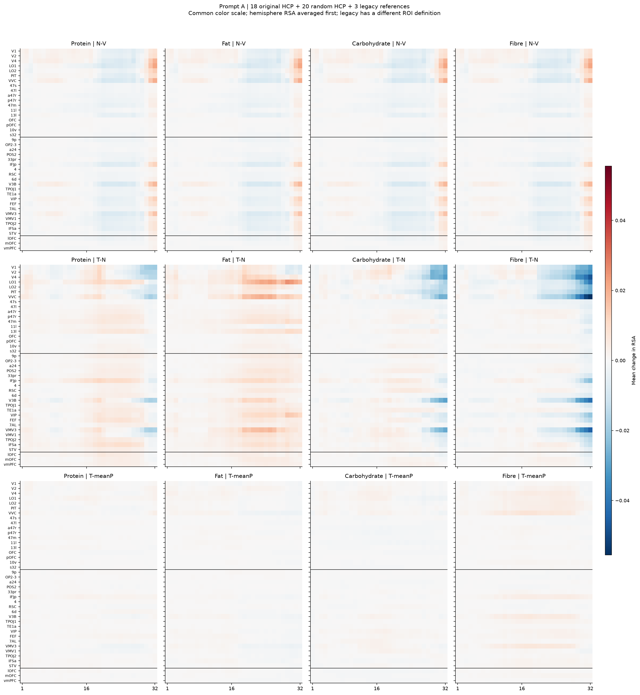
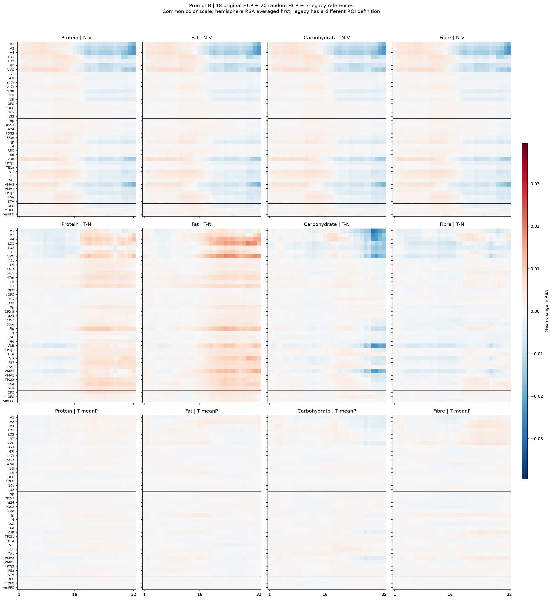

# 输入条件与区域控制对照：v09 修订报告 v02

日期：2026-09-18。**OFC、vmPFC、视觉区域均作为区域控制对照，相互参照；随机HCP区域扩展比较范围。不预设某一区域必须更强。**

本版按用户明确纠正并批准的口径重写解释与阅读顺序。原报告曾错误加入OFC特异性的方向性强假设，现予纠正。既有实验、冻结配置和数值不变；这不是新增实验或追认预注册假设。详见[口径修订记录](../../docs/research/20260918_区域控制对照口径修订_v09_1.md)。

## 研究问题与控制作用

加入营养信息后，模型表征与不同脑区表征的对齐如何变化？这些变化与无关文本、错配营养信息条件相比有什么差异，在OFC、vmPFC、视觉及随机参照区域之间呈现怎样的分布？

输入控制包括图片基线V、正确营养T、五套错配营养P和三套本次无关文本N。区域控制比较不同区域的分数和条件差值；任何区域都不预设应有或应无效应。视觉或随机区域出现较大变化，同样是区域比较的结果。

## 结果概览

- 条件差值随营养、区域、层与提示变化，应结合各区域的绝对分数解释，不能用一个区域概括整个项目。
- 在OFC九区汇总中，蛋白质、脂肪的全层T−V及T−N在A/B均为正；碳水的T−V均负而T−N为正；纤维T−N随提示变号。
- 高阶视觉中，脂肪全层T−V及T−N在A/B均为正，数值大于OFC九区对应差值。早中视觉、高阶视觉的分数分开呈现，不能合成一个“视觉效应”。
- 原vmPFC球中的N−V在全层A约−0.00018、B约+0.00108，显示本次无关文本的变化也有区域与提示依赖。其定义与HCP分区汇总有别，结果单列。
- 随机区域提供其他皮层分区的条件变化分布；全部20对结果与原区域一同保留。既有随机九区位置只作补充描述。
- T−P独立于T−N解读。以OFC九区为例，蛋白质／脂肪全层T−P均值约+0.00006至+0.00020，五套P实现范围跨零；其他区域的T−P在下表及全部区域表中并列报告，不由这一例子推断全项目机制。

以上均为描述性结果，没有显著性或等效性检验，也不按某一区域胜出与否判定实验成功或失败。

## 完成范围

- 模型：同版本 Qwen3.5-9B，三套无关文本 × 401 图 × A/B，共 **2,406 个新增输入、192 张逐层模型 RDM**。关闭 thinking，BF16，32 层、同一最后 prompt token。
- 脑侧：原18对HCP＋固定抽取20对HCP＋旧vmPFC/AAL-lOFC/AAL-mOFC，最终 **41 套区域结果**，另保留原5组摘要。全部76个HCP单侧及旧3个ROI分数独立保存。
- 新增 **1,160 张脑 RDM**（40单侧×29人），每个ROI为11,207条有效 valuation LSA trial β，个人有效图数328–401。没有新增脑试次或参与者剔除，没有额外脑预处理。
- 旧 V/T/P 分数原值复用；新区域与旧区域逐人食品配对完全一致。3套N与5套P均先各自计算RSA，再平均分数。

## 各区域的绝对分数与条件差值

下表所有分数和差值均乘以1,000；`1.000`对应ρ或ρ差值`0.001`，不是百分比或标准化效应量。绝对分数按原逐层群体均值等权汇总；差值直接取原全层窗口表，两者数值一致性另行核验。

T−V为正确营养相对图片基线的变化，N−V为本次无关文本自身的变化，T−N为两类文本之差，T−P为正确与错配营养之差。正差值不自动意味着绝对RSA为正；T−N为正也不自动意味着T−V为正。同一配对下T−V=(N−V)+(T−N)只是分数恒等式，不是因果中介分解。

为便于阅读，主表并列列出既有OFC汇总、原三ROI、10v/s32和两组视觉汇总；选择仅改变展示，不新增ROI或统计主效应。OFC汇总相互重叠，不是独立复制；旧三ROI与HCP分区保持不同测量定义。全部41区域及5组摘要、两个层窗口见[全部区域并列摘要](全部区域并列摘要.md)和[数值表](parallel_region_summary.csv)。

### 蛋白质 · 全32层

| 区域 | 提示 | V | T | 平均N | 平均P | T−V | N−V | T−N | T−P |
| --- | --- | --- | --- | --- | --- | --- | --- | --- | --- |
| OFC_nine | A | -0.411 | +0.476 | -1.033 | +0.277 | +0.887 | -0.622 | +1.509 | +0.199 |
| OFC_nine | B | -1.099 | +0.195 | -1.366 | +0.080 | +1.294 | -0.267 | +1.562 | +0.115 |
| lateral_OFC | A | -0.689 | +0.288 | -1.456 | +0.029 | +0.978 | -0.767 | +1.745 | +0.260 |
| lateral_OFC | B | -1.376 | +0.139 | -1.698 | -0.081 | +1.515 | -0.322 | +1.837 | +0.220 |
| medial_OFC | A | -0.062 | +0.711 | -0.504 | +0.588 | +0.773 | -0.442 | +1.215 | +0.123 |
| medial_OFC | B | -0.753 | +0.266 | -0.951 | +0.282 | +1.019 | -0.199 | +1.217 | -0.016 |
| lOFC | A | +0.638 | +2.041 | -0.360 | +1.560 | +1.402 | -0.999 | +2.401 | +0.481 |
| lOFC | B | -0.517 | +1.477 | -1.110 | +1.093 | +1.995 | -0.593 | +2.588 | +0.384 |
| mOFC | A | -0.872 | +0.310 | -1.071 | +0.337 | +1.182 | -0.199 | +1.381 | -0.027 |
| mOFC | B | -1.879 | -0.821 | -1.493 | -0.600 | +1.058 | +0.385 | +0.673 | -0.221 |
| vmPFC | A | -1.935 | -0.414 | -2.113 | -0.641 | +1.522 | -0.178 | +1.699 | +0.227 |
| vmPFC | B | -2.934 | -1.319 | -1.849 | -1.674 | +1.615 | +1.085 | +0.530 | +0.355 |
| 10v | A | -1.369 | -0.679 | -1.370 | -0.748 | +0.690 | -0.001 | +0.691 | +0.069 |
| 10v | B | -1.995 | -1.432 | -1.648 | -1.325 | +0.564 | +0.348 | +0.216 | -0.107 |
| s32 | A | +0.017 | +0.470 | -0.281 | +0.500 | +0.453 | -0.298 | +0.751 | -0.030 |
| s32 | B | -0.780 | -0.215 | -0.672 | -0.189 | +0.565 | +0.108 | +0.457 | -0.026 |
| early_intermediate_visual | A | -12.492 | -14.322 | -12.297 | -14.789 | -1.830 | +0.195 | -2.025 | +0.467 |
| early_intermediate_visual | B | -9.025 | -12.304 | -13.017 | -12.687 | -3.280 | -3.993 | +0.713 | +0.383 |
| higher_visual | A | -7.533 | -7.471 | -8.225 | -7.845 | +0.062 | -0.692 | +0.754 | +0.374 |
| higher_visual | B | -7.338 | -7.800 | -8.544 | -8.101 | -0.462 | -1.206 | +0.744 | +0.302 |

### 脂肪 · 全32层

| 区域 | 提示 | V | T | 平均N | 平均P | T−V | N−V | T−N | T−P |
| --- | --- | --- | --- | --- | --- | --- | --- | --- | --- |
| OFC_nine | A | -0.411 | +0.859 | -1.033 | +0.746 | +1.270 | -0.622 | +1.892 | +0.113 |
| OFC_nine | B | -1.099 | +0.473 | -1.366 | +0.410 | +1.571 | -0.267 | +1.839 | +0.062 |
| lateral_OFC | A | -0.689 | +0.783 | -1.456 | +0.674 | +1.472 | -0.767 | +2.239 | +0.109 |
| lateral_OFC | B | -1.376 | +0.278 | -1.698 | +0.268 | +1.654 | -0.322 | +1.976 | +0.010 |
| medial_OFC | A | -0.062 | +0.955 | -0.504 | +0.837 | +1.017 | -0.442 | +1.459 | +0.118 |
| medial_OFC | B | -0.753 | +0.716 | -0.951 | +0.588 | +1.469 | -0.199 | +1.667 | +0.128 |
| lOFC | A | +0.638 | +1.833 | -0.360 | +1.643 | +1.195 | -0.999 | +2.193 | +0.190 |
| lOFC | B | -0.517 | +1.501 | -1.110 | +1.545 | +2.019 | -0.593 | +2.612 | -0.044 |
| mOFC | A | -0.872 | +1.063 | -1.071 | +1.100 | +1.935 | -0.199 | +2.134 | -0.036 |
| mOFC | B | -1.879 | -0.180 | -1.493 | -0.226 | +1.699 | +0.385 | +1.314 | +0.046 |
| vmPFC | A | -1.935 | -0.318 | -2.113 | -0.041 | +1.618 | -0.178 | +1.795 | -0.277 |
| vmPFC | B | -2.934 | -1.134 | -1.849 | -0.682 | +1.800 | +1.085 | +0.715 | -0.452 |
| 10v | A | -1.369 | -0.141 | -1.370 | -0.116 | +1.228 | -0.001 | +1.229 | -0.025 |
| 10v | B | -1.995 | -0.885 | -1.648 | -1.060 | +1.111 | +0.348 | +0.763 | +0.176 |
| s32 | A | +0.017 | +0.769 | -0.281 | +0.848 | +0.752 | -0.298 | +1.050 | -0.079 |
| s32 | B | -0.780 | +0.102 | -0.672 | +0.250 | +0.882 | +0.108 | +0.774 | -0.148 |
| early_intermediate_visual | A | -12.492 | -9.662 | -12.297 | -10.233 | +2.830 | +0.195 | +2.636 | +0.571 |
| early_intermediate_visual | B | -9.025 | -9.763 | -13.017 | -10.759 | -0.738 | -3.993 | +3.255 | +0.997 |
| higher_visual | A | -7.533 | -1.923 | -8.225 | -2.080 | +5.609 | -0.692 | +6.302 | +0.157 |
| higher_visual | B | -7.338 | -3.729 | -8.544 | -4.062 | +3.609 | -1.206 | +4.815 | +0.333 |

### 碳水 · 全32层

| 区域 | 提示 | V | T | 平均N | 平均P | T−V | N−V | T−N | T−P |
| --- | --- | --- | --- | --- | --- | --- | --- | --- | --- |
| OFC_nine | A | -0.411 | -0.912 | -1.033 | -0.436 | -0.502 | -0.622 | +0.121 | -0.476 |
| OFC_nine | B | -1.099 | -1.211 | -1.366 | -1.300 | -0.112 | -0.267 | +0.155 | +0.089 |
| lateral_OFC | A | -0.689 | -1.393 | -1.456 | -0.875 | -0.704 | -0.767 | +0.063 | -0.518 |
| lateral_OFC | B | -1.376 | -1.702 | -1.698 | -1.678 | -0.327 | -0.322 | -0.004 | -0.024 |
| medial_OFC | A | -0.062 | -0.312 | -0.504 | +0.113 | -0.250 | -0.442 | +0.192 | -0.424 |
| medial_OFC | B | -0.753 | -0.596 | -0.951 | -0.827 | +0.157 | -0.199 | +0.355 | +0.230 |
| lOFC | A | +0.638 | -0.622 | -0.360 | +0.083 | -1.260 | -0.999 | -0.262 | -0.706 |
| lOFC | B | -0.517 | -0.855 | -1.110 | -1.121 | -0.338 | -0.593 | +0.255 | +0.266 |
| mOFC | A | -0.872 | -0.400 | -1.071 | +0.035 | +0.472 | -0.199 | +0.671 | -0.436 |
| mOFC | B | -1.879 | -0.776 | -1.493 | -0.658 | +1.103 | +0.385 | +0.718 | -0.117 |
| vmPFC | A | -1.935 | -1.231 | -2.113 | -0.856 | +0.705 | -0.178 | +0.883 | -0.375 |
| vmPFC | B | -2.934 | -2.208 | -1.849 | -2.058 | +0.726 | +1.085 | -0.359 | -0.151 |
| 10v | A | -1.369 | -0.544 | -1.370 | -0.248 | +0.825 | -0.001 | +0.826 | -0.296 |
| 10v | B | -1.995 | -0.720 | -1.648 | -0.600 | +1.275 | +0.348 | +0.928 | -0.120 |
| s32 | A | +0.017 | -0.452 | -0.281 | +0.008 | -0.469 | -0.298 | -0.171 | -0.460 |
| s32 | B | -0.780 | -0.816 | -0.672 | -0.393 | -0.036 | +0.108 | -0.143 | -0.423 |
| early_intermediate_visual | A | -12.492 | -15.533 | -12.297 | -16.028 | -3.041 | +0.195 | -3.236 | +0.495 |
| early_intermediate_visual | B | -9.025 | -16.915 | -13.017 | -15.884 | -7.891 | -3.993 | -3.898 | -1.031 |
| higher_visual | A | -7.533 | -11.269 | -8.225 | -11.725 | -3.736 | -0.692 | -3.044 | +0.456 |
| higher_visual | B | -7.338 | -12.158 | -8.544 | -12.373 | -4.820 | -1.206 | -3.614 | +0.215 |

### 纤维 · 全32层

| 区域 | 提示 | V | T | 平均N | 平均P | T−V | N−V | T−N | T−P |
| --- | --- | --- | --- | --- | --- | --- | --- | --- | --- |
| OFC_nine | A | -0.411 | -1.321 | -1.033 | -1.535 | -0.911 | -0.622 | -0.289 | +0.213 |
| OFC_nine | B | -1.099 | -1.266 | -1.366 | -1.229 | -0.167 | -0.267 | +0.100 | -0.037 |
| lateral_OFC | A | -0.689 | -1.807 | -1.456 | -2.002 | -1.118 | -0.767 | -0.351 | +0.194 |
| lateral_OFC | B | -1.376 | -1.509 | -1.698 | -1.458 | -0.133 | -0.322 | +0.189 | -0.050 |
| medial_OFC | A | -0.062 | -0.714 | -0.504 | -0.951 | -0.652 | -0.442 | -0.211 | +0.237 |
| medial_OFC | B | -0.753 | -0.962 | -0.951 | -0.943 | -0.209 | -0.199 | -0.010 | -0.019 |
| lOFC | A | +0.638 | -0.402 | -0.360 | -0.884 | -1.040 | -0.999 | -0.041 | +0.482 |
| lOFC | B | -0.517 | -0.618 | -1.110 | -0.743 | -0.101 | -0.593 | +0.492 | +0.125 |
| mOFC | A | -0.872 | -0.254 | -1.071 | -1.211 | +0.618 | -0.199 | +0.817 | +0.957 |
| mOFC | B | -1.879 | -1.232 | -1.493 | -1.377 | +0.646 | +0.385 | +0.261 | +0.144 |
| vmPFC | A | -1.935 | -1.465 | -2.113 | -1.634 | +0.470 | -0.178 | +0.648 | +0.168 |
| vmPFC | B | -2.934 | -2.375 | -1.849 | -1.824 | +0.560 | +1.085 | -0.525 | -0.551 |
| 10v | A | -1.369 | -0.386 | -1.370 | -1.328 | +0.984 | -0.001 | +0.985 | +0.943 |
| 10v | B | -1.995 | -0.998 | -1.648 | -1.338 | +0.998 | +0.348 | +0.650 | +0.340 |
| s32 | A | +0.017 | -0.118 | -0.281 | -0.619 | -0.134 | -0.298 | +0.163 | +0.501 |
| s32 | B | -0.780 | -0.713 | -0.672 | -0.945 | +0.067 | +0.108 | -0.041 | +0.232 |
| early_intermediate_visual | A | -12.492 | -19.480 | -12.297 | -20.817 | -6.988 | +0.195 | -7.183 | +1.337 |
| early_intermediate_visual | B | -9.025 | -13.993 | -13.017 | -14.514 | -4.969 | -3.993 | -0.976 | +0.521 |
| higher_visual | A | -7.533 | -15.448 | -8.225 | -18.221 | -7.916 | -0.692 | -7.224 | +2.773 |
| higher_visual | B | -7.338 | -11.887 | -8.544 | -13.291 | -4.549 | -1.206 | -3.343 | +1.404 |

## 全区域与逐层曲线

全部41区域的既有图首先并列提供：

下列曲线保留既有绘图顺序，该顺序不定义主要区域。

下图保留全部32层。N在四种营养间共享，因此重复的N−V行不是四次独立重复。绝对分数图中的阴影只是三套N／五套P之间的实现范围，**不是置信区间**。

B图见 [B控制对比](../20260918_控制实验报告_v01/figures/contrasts_B.png)、[B绝对RSA](../20260918_控制实验报告_v01/figures/absolute_B.png)。

## 无关文本自身的区域差异（N−V）

| 区域 | 全层 A | 全层 B | 深层 A | 深层 B |
| --- | --- | --- | --- | --- |
| OFC_nine | -0.622 | -0.267 | -1.026 | -1.224 |
| higher_visual | -0.692 | -1.206 | -1.719 | -5.765 |
| early_intermediate_visual | +0.195 | -3.993 | -1.620 | -11.160 |
| lOFC | -0.999 | -0.593 | -1.446 | -2.191 |
| mOFC | -0.199 | +0.385 | -0.327 | -0.074 |
| vmPFC | -0.178 | +1.085 | +0.098 | +1.160 |

单位同上。旧3个ROI保持原双侧pattern定义，不能视作与HCP单分区完全相同的测量单位。

## 实现范围与个体分布

三套N是同一组401条文本的三次图片分配；五套P为既有营养错配。其范围表示具体实现的不稳定性，不是人口或刺激总体不确定性。[全部实现范围表](../20260918_控制实验报告_v01/implementation_ranges.csv) 列N1–N3、N/P均值和范围；原始P1–P5分数完整保留在RSA数组中。

[深层逐人分布](../20260918_控制实验报告_v01/figures/participants_deep17_32.png)；所有分区、个体、层窗口见 [逐人表](../20260918_控制RSA_v01/participant_window_summary.csv)。

## 控制条件及解释边界

无关文本为可读的物体词列表，例如 `Reference words: prism, pipe, valve, switch.`，放在原营养行相同位置。没有数字、单位或营养身份；四营养共享。

| 插入行 | token数：最小／中位／最大 |
| --- | --- |
| N1/N2/N3 | 11／11／13 |
| 蛋白质 T | 16／16／17 |
| 脂肪 T | 15／15／16 |
| 碳水 T | 17／18／18 |
| 纤维 T | 16／16／17 |

A完整输入：V303、N315–317、T319–322个token；B相应增加4个。各P与同营养T的长度分布一致，具体逐图值见 [全部token记录（本分享包未收录）](../../SHARING.md#未收录材料)。**N不是等长、同句法或同数字格式控制**；其含义也不是真正的“无语义”。

因此：

1. T−N为正支持营养行优于这类随机物体词列表，不能单独证明营养知识是唯一有效成分。
2. T−N为正而T−V为负，只能说营养条件下降较少，不能称净对齐提升。
3. T−N不能替代T−P；正确对应是否关键，仍取决于原匹配对比。
4. N和T分数相近不证明表征几何相同；未做等效性检验，也不能把小差异称为“没有作用”。
5. 随机分区和九区组合的排序是描述性的；没有显著性检验，没有对所有皮层区域或新食品的总体推断。
6. 所有控制都在已经见过v08结果后确定。全层为本轮固定摘要，深层窗口为事后探索；不将其包装成独立验证性发现。

## 补充描述：既有区域差值与随机分区参照

以下保留原来计算的OFC−高阶视觉差值及九区参照位置，仅用于描述区域分布。差值的减法顺序不代表预期方向；本次不新增其他成对比较或显著性检验。

### OFC九区−高阶视觉的既有差值

| 营养 | 提示 | 全层Δ(T−V) | 全层Δ(T−N) | 全层Δ(T−P) | 深层Δ(T−V) | 深层Δ(T−N) | 深层Δ(T−P) |
| --- | --- | --- | --- | --- | --- | --- | --- |
| 蛋白质 | A | +0.825 | +0.755 | -0.175 | +2.695 | +2.001 | -0.220 |
| 蛋白质 | B | +1.756 | +0.817 | -0.187 | +3.445 | -1.096 | -0.699 |
| 脂肪 | A | -4.339 | -4.409 | -0.044 | -6.647 | -7.341 | +0.693 |
| 脂肪 | B | -2.037 | -2.976 | -0.270 | -2.148 | -6.689 | +0.274 |
| 碳水 | A | +3.234 | +3.165 | -0.933 | +7.243 | +6.550 | -0.473 |
| 碳水 | B | +4.708 | +3.770 | -0.126 | +10.076 | +5.536 | +0.292 |
| 纤维 | A | +7.005 | +6.935 | -2.559 | +13.747 | +13.053 | -3.472 |
| 纤维 | B | +4.382 | +3.443 | -1.441 | +7.897 | +3.356 | -2.444 |

这里 Δ=OFC九区−高阶视觉四区。差值为正表示前者数值大于后者，也可能来自后者下降更多；正负方向均须结合两侧自身变化和绝对RSA。这里未检验区域差异的显著性。

### 20对随机区域及既有匹配描述

抽样前冻结名单：9p、OP2-3、a24、POS2、33pr、IFJp、4、RSC、6d、V3B、TPOJ1、TE1a、VIP、FEF、7AL、VMV3、VMV1、TPOJ2、IFSa、STV。它们是解剖学随机参照，**不是已知不参与任务的负对照区**。

匹配条件预先固定为：LOSO均值差≤0.02、每侧固定体素数的参与者中位数比0.5–2；至少5个参照才描述条件内位置。LOSO是跨人共同RDM一致性，不是重测可靠性或应当除掉的噪声。此匹配也没有解决所有空间、覆盖和信噪比差异。

#### OFC分区及10v/s32的既有可比参照数量

| 分区 | LOSO | 每侧体素中位数 | 可比分区数 | 处理 |
| --- | --- | --- | --- | --- |
| 47s | 0.0025 | 364 | 10 | 可描述比较 |
| 47l | 0.0037 | 312 | 11 | 可描述比较 |
| a47r | 0.0043 | 488 | 10 | 可描述比较 |
| p47r | 0.0081 | 240 | 10 | 可描述比较 |
| 47m | 0.0168 | 96 | 2 | 参照不足 |
| 11l | 0.0016 | 452 | 10 | 可描述比较 |
| 13l | 0.0175 | 250 | 11 | 可描述比较 |
| OFC | -0.0002 | 572 | 7 | 可描述比较 |
| pOFC | 0.0009 | 330 | 11 | 可描述比较 |
| 10v | -0.0007 | 380 | 9 | 可描述比较 |
| s32 | 0.0017 | 100 | 2 | 参照不足 |

#### 既有九区汇总的描述性位置

从已抽取20对分区构成1,000个冻结九区组合，保持左右等权、九分区等权。以下“低于OFC比例”仅表示这批描述性组合中的位置；组合共享分区，**不是独立抽样，也不是全脑零分布或p值**。

| 营养 | 提示 | T−V：全部组合低于OFC比例 | T−N：全部组合低于OFC比例 | 可比九区组合数 | T−N：可比组合低于OFC比例 |
| --- | --- | --- | --- | --- | --- |
| 蛋白质 | A | 44.1% | 39.8% | 327 | 19.0% |
| 蛋白质 | B | 67.3% | 71.3% | 327 | 51.4% |
| 脂肪 | A | 0.0% | 0.0% | 327 | 0.0% |
| 脂肪 | B | 0.0% | 0.5% | 327 | 1.5% |
| 碳水 | A | 56.4% | 48.8% | 327 | 4.3% |
| 碳水 | B | 93.4% | 99.0% | 327 | 96.9% |
| 纤维 | A | 98.4% | 98.7% | 327 | 96.0% |
| 纤维 | B | 99.4% | 99.9% | 327 | 99.7% |

全部18个原HCP分区的匹配名单及条件内位置见 [参照位置表](../20260918_控制实验报告_v01/individual_HCP_reference_positions.csv) 和 [实际匹配名单](../20260918_控制实验报告_v01/matched_reference_members.json)。[所有区域QC](../20260918_控制实验报告_v01/ROI_quality_summary.csv) 同时保留覆盖、session/run结构。旧3个ROI参与区域控制对照；因测量定义不同，在这一匹配排名中仅标注、不作严格同单位排名；原ROI与新分区组织重叠见 [重叠表（本分享包未收录）](../../SHARING.md#未收录材料)。

## 数值来源与版本验证

本次仅重排已有数值并修订解释。旧实验核查记录描述的是原运行；本次文件保全、链接、全区域覆盖与摘要一致性见[修订核查](revision_audit.json)。原v01报告及原报告生成脚本保留为历史，不再作为当前口径入口。

[独立验证](../20260918_控制实验报告_v01/independent_validation.json) 检查：2,406个实际输入与推理前token哈希一致；6套矩阵与服务器缓存哈希一致；旧V/T/P逐值不变；79个ROI逐人的食品配对相同；左右及分区聚合正确；四项对比恒等式成立；全层/深层导出、随机九区组合和匹配规则可复算。对单个新旧ROI另用独立Spearman实现核对。

模型原始逐图缓存留在获授权服务器，完整hidden矩阵、概率和输入元数据已存本项目。个体脑模式及评分没有上传服务器。冻结输入、模型revision、依赖版本、随机种子、代码基线与脚本哈希均有记录。

一次本地RSA在B矩阵尚未完成传输时暂停，已保留为中断记录；传输与哈希校验完成后重新运行，A重跑与中断前结果逐值一致。不涉及新推理、设计变更或效果筛选。

### 文件入口

- [冻结方案](../../docs/research/20260918_无关词与随机分区健壮性设计_v09.md)
- [逐层绝对分数及N/P范围](../20260918_控制RSA_v01/absolute_curves.csv)
- [全部逐层对比](../20260918_控制RSA_v01/contrast_curves.csv)
- [全层与深层摘要](../20260918_控制RSA_v01/window_summary.csv)
- [A：全部41区域](../20260918_控制实验报告_v01/figures/all41_heatmap_A.png)／[B：全部41区域](../20260918_控制实验报告_v01/figures/all41_heatmap_B.png)
- [数组维度、顺序与全部ROI](../20260918_控制RSA_v01/index.json)
- [完成回执](../20260918_控制实验报告_v01/completion_receipt.json)
