# 输入条件与区域控制对照：完整描述性报告 v03

日期：2026-09-18。OFC、vmPFC、视觉区域相互参照，固定随机区域扩展比较范围；不预设哪个区域更强。本文补齐v02尚缺的曲线、个体分布、一致性及分营养综合解读，全部基于已完成的v09分数。无新增模型输入、脑提取或RSA重算，无显著性／等效性检验。

## 研究范围与阅读方法

研究问题：营养输入相对图片基线、无关文本及错配营养条件，怎样改变模型与各脑区的表征对齐？区域之间呈现哪些相同和不同模式？操纵发生在模型输入端，人类数据来自既有任务，不能将这些差值解释成人脑接受营养提示后的因果效应。

29人、401图共同范围，四营养各自一行g/100 g，A主提示/B措辞稳健性，32层。原18对HCP＋20对固定随机HCP＋原vmPFC/lOFC/mOFC共41套区域，另有5组既有汇总。原始行为口径仍为29人、568图、15,869评分；401图每ROI为11,207条脑观测，没有新排除。早期493图kcal结果另存，未混入本报告。

V为图片基线，T为正确营养，N为三套本次无关文本的RSA均值，P为五套错配营养的RSA均值。模型与脑的距离均为1−Pearson，RSA为同食品配对下的Spearman；人是统计单位。HCP先分别计算左右RSA再平均，旧三ROI保持原双侧pattern定义。

四项对比：T−V为相对图片基线的变化；N−V为本次无关文本自身变化；T−N为两类文本之差；T−P为正确与错配之差。始终与绝对分数一起看。N−V＋T−N＝T−V是数值恒等式，不是因果分解。

正文先报告全32层；L17–32保留为已见v08结果后选定的探索窗口，所有表和个体图均有该版本。所有表中ρ与差值均乘1,000；CSV保存原值。正负按未四舍五入值判断，没有实际等效阈值。N/P范围不是置信区间，A/B不是独立复制。

## 全区域总览

41个区域的四项差值全部保留。色标在同一对比下跨A/B和四种营养固定，零为中心；不同对比有不同色标，须读取数值而非跨对比按颜色比较。

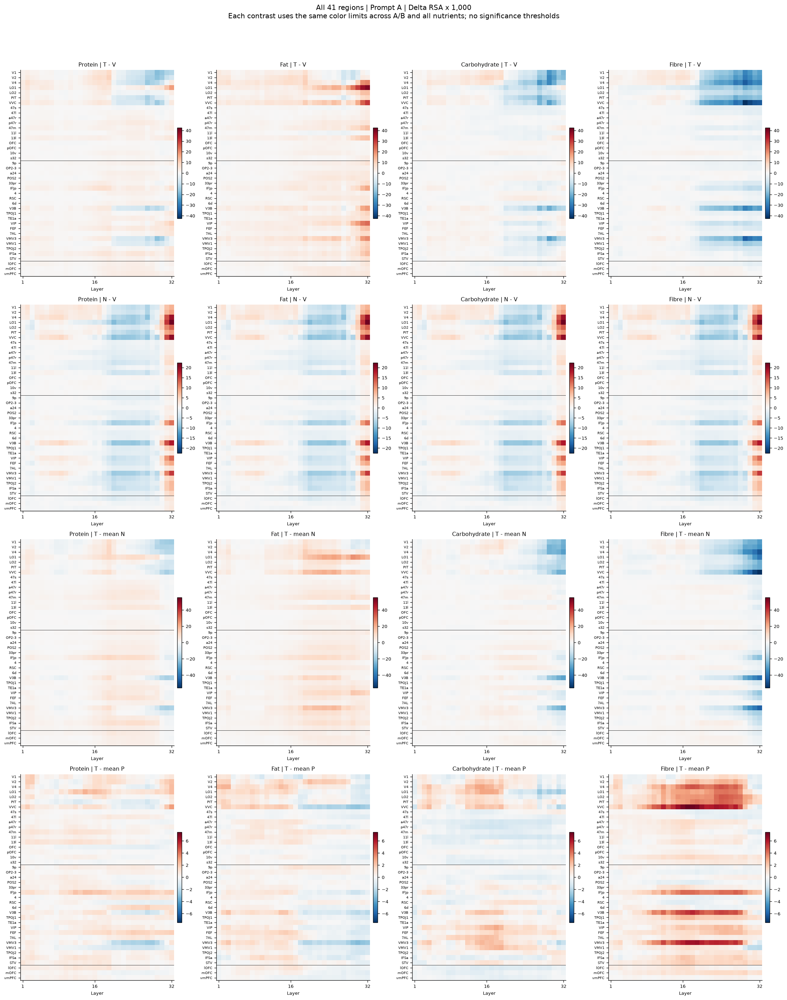

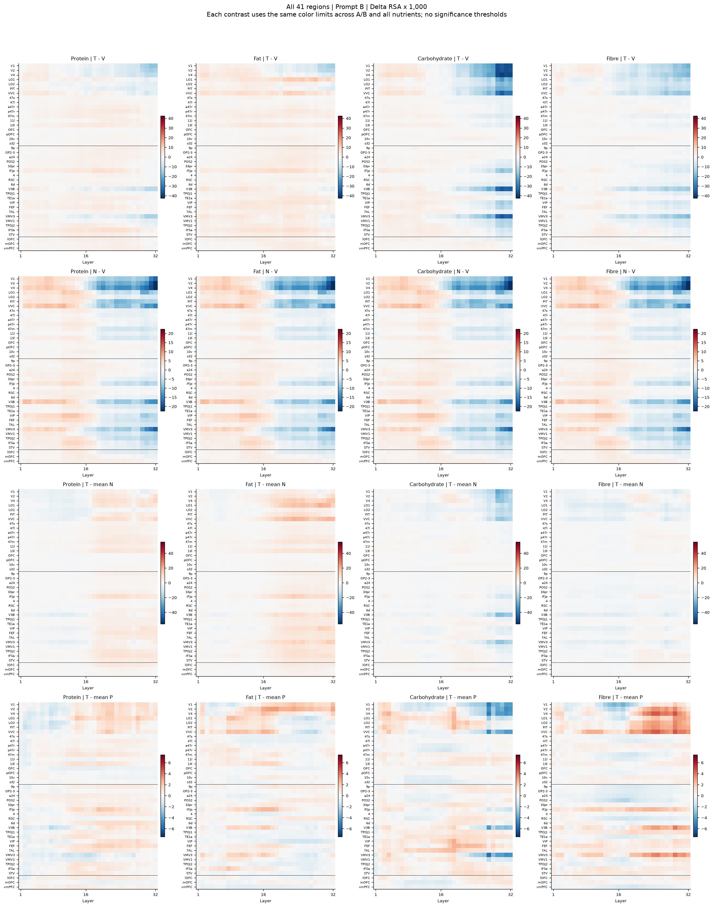

[全部区域绝对分数与窗口摘要](全部区域并列摘要.md) · [逐区域完整曲线索引](逐区域曲线索引.md)。正文六组面板用于阅读，全部41区域及原5组汇总都有独立曲线页，不按效果挑选。重叠OFC汇总不当作独立证据。

## 四种营养的综合解读

### 蛋白质

蛋白质的T−V在OFC九区及原vmPFC、lOFC、mOFC的A/B全层均值均为正；视觉区域的情况不同：早中视觉均为负，高阶视觉由A的小正值转为B的负值。T−N在这些前额叶ROI及高阶视觉中均正，早中视觉则由A负转B正。因此，“相对无关文本更高”与“相对图片基线更高”需分别陈述。

正确匹配的T−P在OFC九区、vmPFC、lOFC和两组视觉的全层均值均正，原mOFC均负。OFC九区全层T−P正向人数仅A14/29、B15/29，不能由正均值概括为所有人同向。T−N方面，OFC九区为23/29、24/29，而高阶视觉虽A/B均为18/29，只有11人两提示都正；群体均值同向不等于同一批个体一致。

三套N下，OFC九区、vmPFC与mOFC的全层T−N在A/B逐套均正；高阶视觉B只有2/3套为正。OFC九区T−P在A/B均为4/5套正，说明其均值方向仍受具体错配实现影响。随机20区的T−V在A/B有相同17区为正、3区为负；T−N有16区两提示都正。正向变化分布于多个区域，这是区域控制的实际结果。

| 区域 | T−V A/B | T−N A/B | T−P A/B | T−V正向人数 A/B | T−N正向人数 A/B |
| --- | --- | --- | --- | --- | --- |
| OFC_nine | +0.887 / +1.294 | +1.509 / +1.562 | +0.199 / +0.115 | 21 / 22 | 23 / 24 |
| vmPFC | +1.522 / +1.615 | +1.699 / +0.530 | +0.227 / +0.355 | 19 / 24 | 22 / 17 |
| lOFC | +1.402 / +1.995 | +2.401 / +2.588 | +0.481 / +0.384 | 20 / 21 | 20 / 22 |
| mOFC | +1.182 / +1.058 | +1.381 / +0.673 | -0.027 / -0.221 | 20 / 19 | 19 / 17 |
| early_intermediate_visual | -1.830 / -3.280 | -2.025 / +0.713 | +0.467 / +0.383 | 11 / 11 | 12 / 16 |
| higher_visual | +0.062 / -0.462 | +0.754 / +0.744 | +0.374 / +0.302 | 16 / 14 | 18 / 18 |

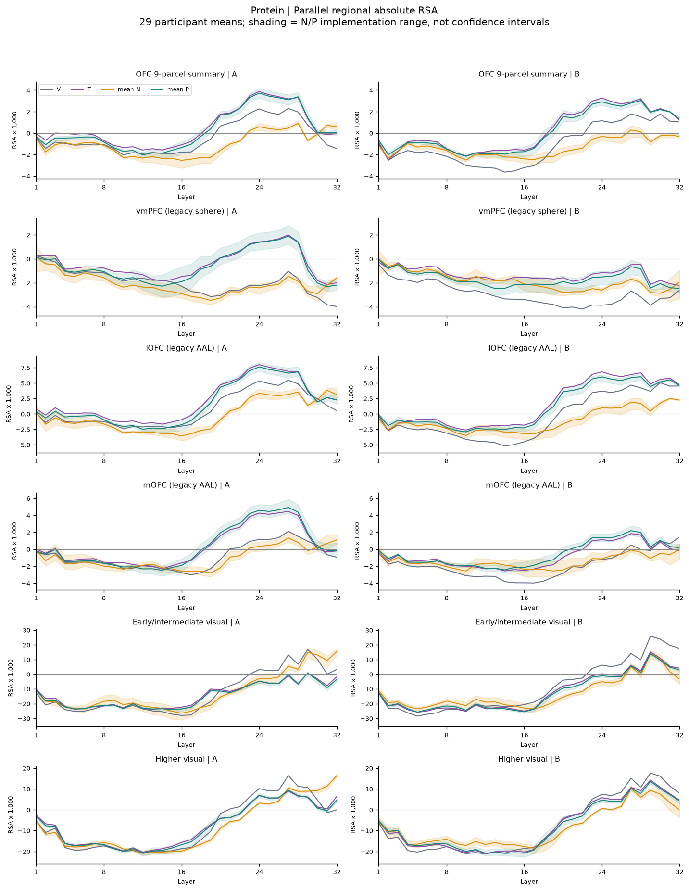

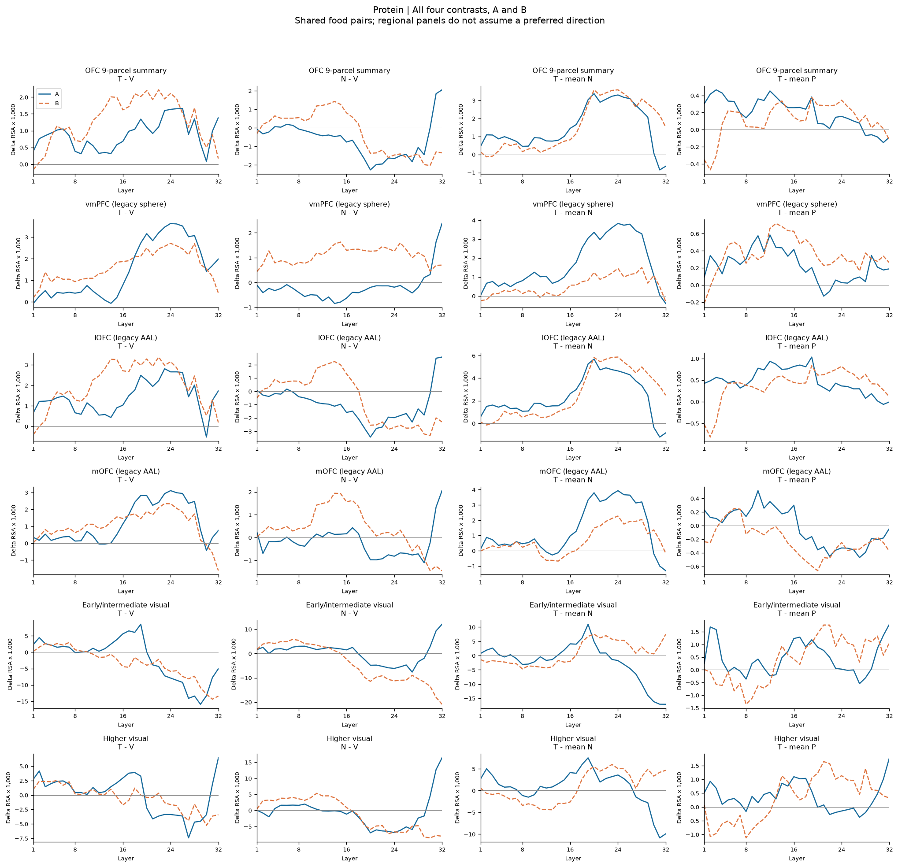

[蛋白质全层逐人分布](figures/participants_0_all32.png) · [蛋白质探索深层逐人分布](figures/participants_0_deep17_32.png) · [蛋白质随机20区](figures/random_0.png)

### 脂肪

脂肪的T−V、T−N在OFC九区、vmPFC、lOFC、mOFC和高阶视觉的A/B全层均值均正；高阶视觉的对应差值数值较大。早中视觉T−V由A正转B负，但T−N仍在A/B均正，所以不能将两组视觉合并为同一种变化。

匹配对比呈另一种分布：vmPFC的T−P在A/B均负，且两提示下逐套五P均为负；OFC九区和高阶视觉均值为正，但各自只有3/5套P差值为正；lOFC、mOFC的T−P随提示变号。由此应区分加入营养文本后的变化与正确数值对应的额外差异。

高阶视觉T−N在A/B各24/29人正向，其中22人两提示都正；OFC九区为21/29、22/29，其中18人两提示都正。随机20区的T−V及T−N在A/B全层均值全部为正，但T−P只有10区两提示都正、6区变号。广泛的输入条件变化并不要求所有区域出现同一种正确匹配差异。

| 区域 | T−V A/B | T−N A/B | T−P A/B | T−V正向人数 A/B | T−N正向人数 A/B |
| --- | --- | --- | --- | --- | --- |
| OFC_nine | +1.270 / +1.571 | +1.892 / +1.839 | +0.113 / +0.062 | 20 / 22 | 21 / 22 |
| vmPFC | +1.618 / +1.800 | +1.795 / +0.715 | -0.277 / -0.452 | 23 / 22 | 21 / 16 |
| lOFC | +1.195 / +2.019 | +2.193 / +2.612 | +0.190 / -0.044 | 19 / 19 | 18 / 22 |
| mOFC | +1.935 / +1.699 | +2.134 / +1.314 | -0.036 / +0.046 | 16 / 19 | 21 / 17 |
| early_intermediate_visual | +2.830 / -0.738 | +2.636 / +3.255 | +0.571 / +0.997 | 20 / 15 | 19 / 19 |
| higher_visual | +5.609 / +3.609 | +6.302 / +4.815 | +0.157 / +0.333 | 22 / 19 | 24 / 24 |

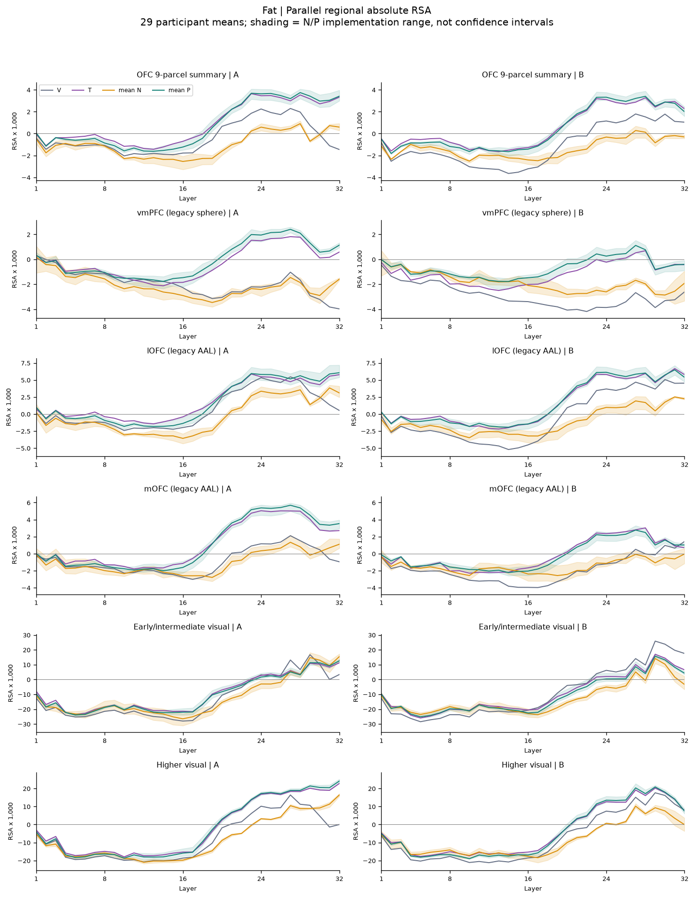

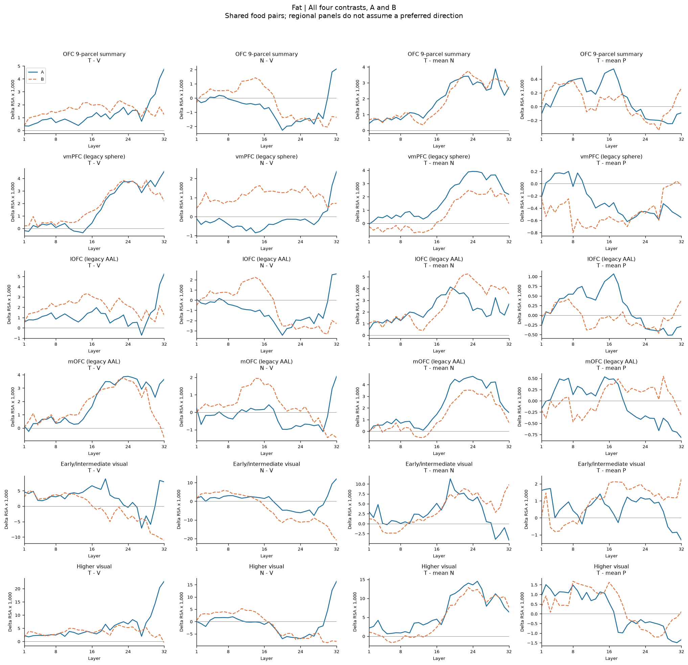

[脂肪全层逐人分布](figures/participants_1_all32.png) · [脂肪探索深层逐人分布](figures/participants_1_deep17_32.png) · [脂肪随机20区](figures/random_1.png)

### 碳水

碳水的区域分布不一致：OFC九区T−V在A/B均负，T−N小幅为正；原mOFC的T−V和T−N均正，原vmPFC的T−V均正而T−N由A正转B负；lOFC的T−V均负、T−N变号。两组视觉的T−V和T−N均负。OFC九区的汇总不能替代原mOFC或各分区，也不能把T−N的小正值写作普遍净提升。

T−P在vmPFC、mOFC均负，在高阶视觉均正，而OFC九区、lOFC与早中视觉随提示变号。高阶视觉T−P均值虽正，逐套P仅A3/5、B2/5为正；原mOFC的T−N则在三套N下均正。不同控制回答不同问题，应完整报告这种交错模式。

高阶视觉T−V正向人数A11/29、B7/29；原mOFC为17/29、16/29，个体仍有正负分布。随机20区中T−V在A/B各8区正，但只有5区两提示都正、6区变号；T−N正向区域由A14区降至B8区。总数相同并不保证是同一批区域。

| 区域 | T−V A/B | T−N A/B | T−P A/B | T−V正向人数 A/B | T−N正向人数 A/B |
| --- | --- | --- | --- | --- | --- |
| OFC_nine | -0.502 / -0.112 | +0.121 / +0.155 | -0.476 / +0.089 | 10 / 14 | 15 / 15 |
| vmPFC | +0.705 / +0.726 | +0.883 / -0.359 | -0.375 / -0.151 | 18 / 19 | 19 / 15 |
| lOFC | -1.260 / -0.338 | -0.262 / +0.255 | -0.706 / +0.266 | 10 / 14 | 13 / 17 |
| mOFC | +0.472 / +1.103 | +0.671 / +0.718 | -0.436 / -0.117 | 17 / 16 | 19 / 18 |
| early_intermediate_visual | -3.041 / -7.891 | -3.236 / -3.898 | +0.495 / -1.031 | 12 / 4 | 11 / 8 |
| higher_visual | -3.736 / -4.820 | -3.044 / -3.614 | +0.456 / +0.215 | 11 / 7 | 11 / 7 |

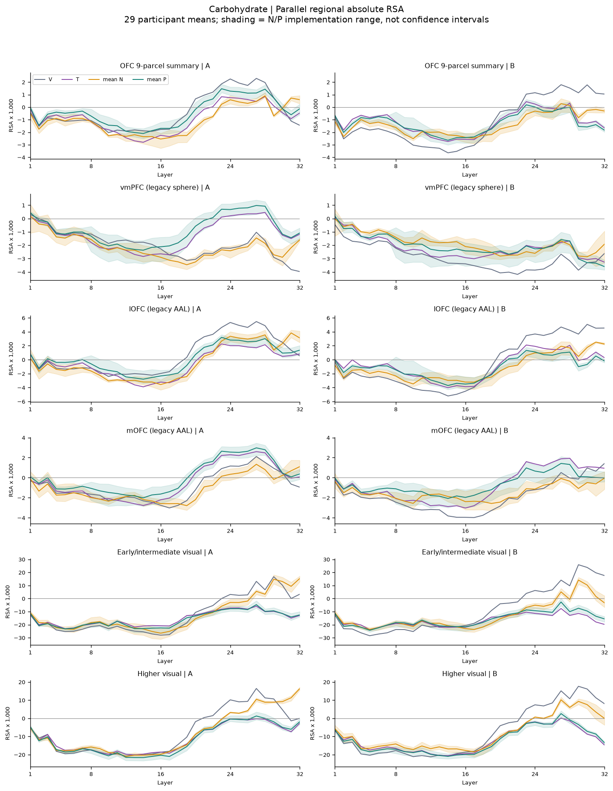

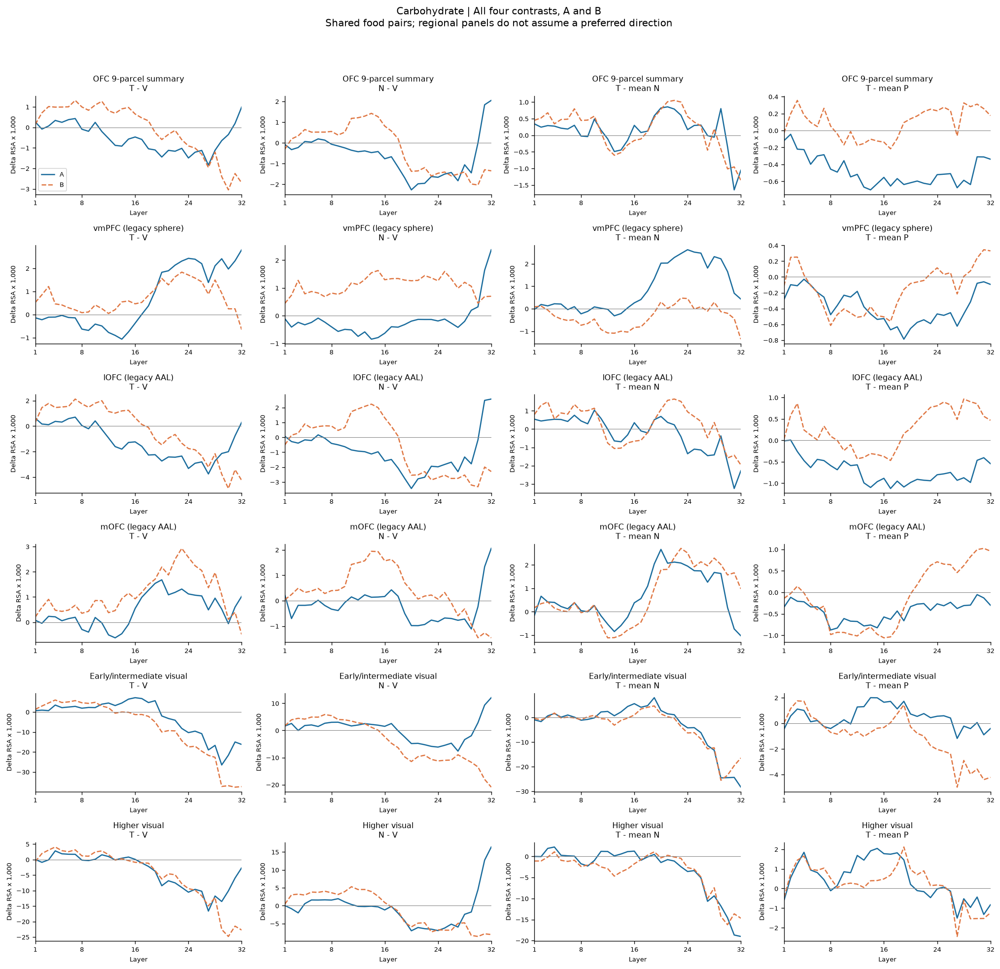

[碳水全层逐人分布](figures/participants_2_all32.png) · [碳水探索深层逐人分布](figures/participants_2_deep17_32.png) · [碳水随机20区](figures/random_2.png)

### 纤维

纤维在OFC九区和两组视觉的T−V全层均值均负；原mOFC与vmPFC均正，lOFC均负。T−N在原mOFC均正，在vmPFC由A正转B负，在OFC九区及lOFC由A负转B正，在两组视觉均负。OFC内部和不同ROI定义之间的差别不能被一个总括结论掩盖。

两组视觉的T−P全层均值为正，同时T−V为负，表示正确条件较错配下降得少，而不是超过图片基线。高阶视觉逐套五P在A/B都出现这一正差值，仍不能改变上述解释。原mOFC的T−V、T−N、T−P均值在A/B均正，但B的T−N只有2/3套N正、T−P只有4/5套P正。vmPFC的T−P由A正转B负，仅4/32层的群体差值在A/B同号。

高阶视觉T−V在A/B均只有7/29人正向，原mOFC为19/29、18/29。随机20区的T−V在A仅1区正、B4区正，16区两提示都负；T−N有10区两提示都负。纤维的主要区域分布与蛋白质、脂肪不同，但错配强度等不相同，不据此给营养做总体强弱排名。

| 区域 | T−V A/B | T−N A/B | T−P A/B | T−V正向人数 A/B | T−N正向人数 A/B |
| --- | --- | --- | --- | --- | --- |
| OFC_nine | -0.911 / -0.167 | -0.289 / +0.100 | +0.213 / -0.037 | 9 / 15 | 10 / 13 |
| vmPFC | +0.470 / +0.560 | +0.648 / -0.525 | +0.168 / -0.551 | 20 / 17 | 17 / 11 |
| lOFC | -1.040 / -0.101 | -0.041 / +0.492 | +0.482 / +0.125 | 11 / 13 | 11 / 16 |
| mOFC | +0.618 / +0.646 | +0.817 / +0.261 | +0.957 / +0.144 | 19 / 18 | 18 / 15 |
| early_intermediate_visual | -6.988 / -4.969 | -7.183 / -0.976 | +1.337 / +0.521 | 7 / 5 | 8 / 14 |
| higher_visual | -7.916 / -4.549 | -7.224 / -3.343 | +2.773 / +1.404 | 7 / 7 | 4 / 9 |

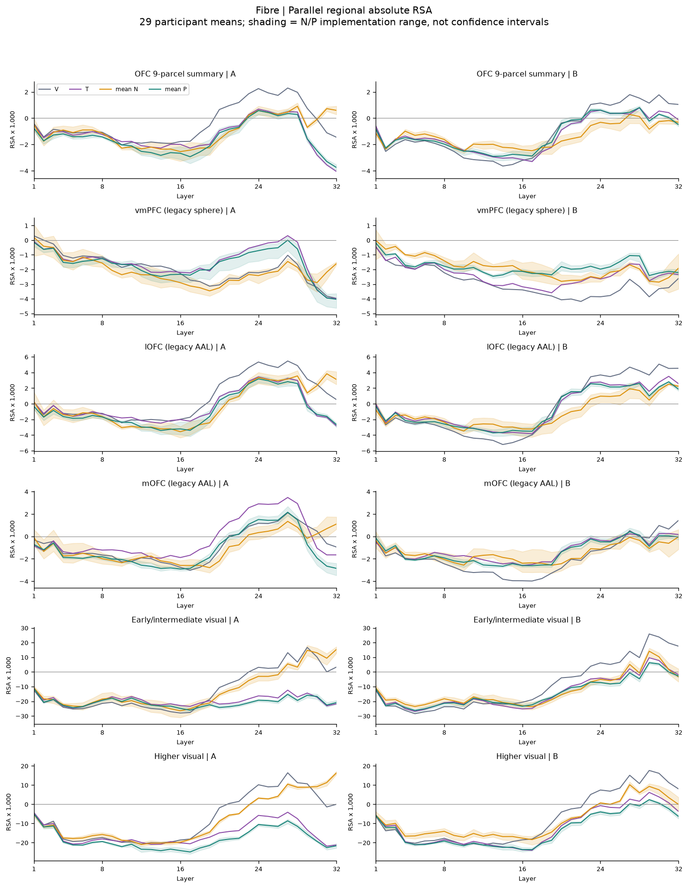

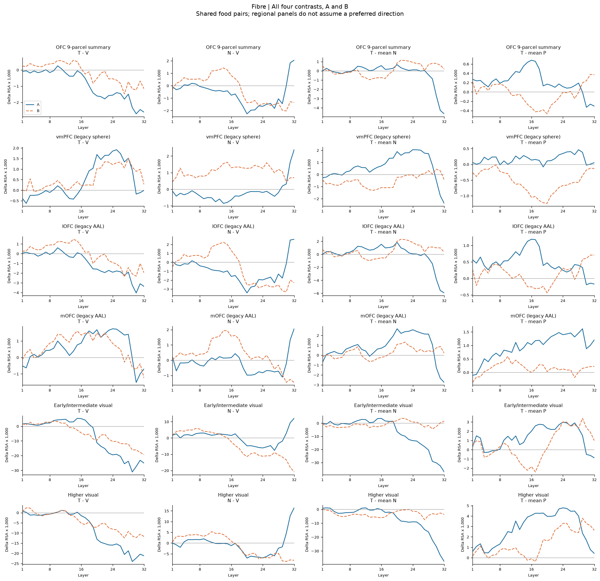

[纤维全层逐人分布](figures/participants_3_all32.png) · [纤维探索深层逐人分布](figures/participants_3_deep17_32.png) · [纤维随机20区](figures/random_3.png)

## 个体差异、A/B与N/P一致性

群体均值、同一人的跨提示方向、逐层方向和具体文本／错配实现是不同层面的描述。逐人图用29个点、黑线均值和紫色虚线中位数；全体区域的中位数、Q25–Q75、正负人数与逐套N/P范围见[完整一致性与个体附录](一致性与个体结果.md)。

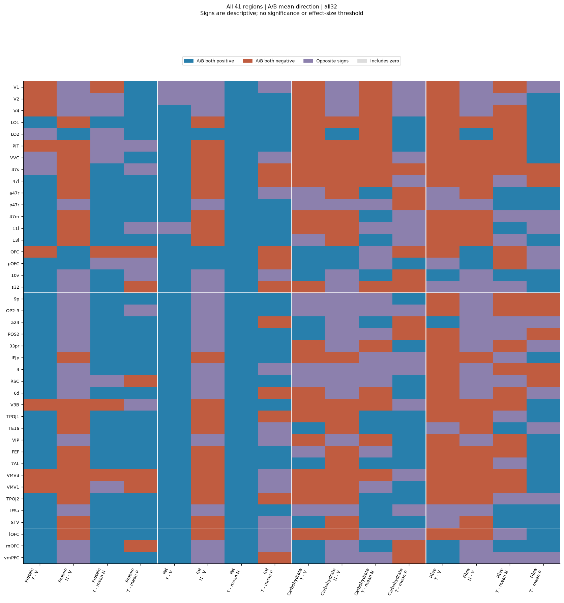

该图只编码符号，不编码显著性或变化量；非常小的差值也可能变号。探索窗口见[深层A/B方向](figures/AB_direction_deep17_32.png)。A/B全层均值同向不能替代32层曲线：例如蛋白质高阶视觉T−N均值A/B都正，但仅13/32层同号；纤维vmPFC的T−P仅4/32层同号。

N在四营养间共享，其N−V重复列不是四份独立证据。具体三套N和五套P均有完整数值，不能把实现数量或同号次数当作人类样本量或显著性水平。

## 随机区域作为并列控制对照

随机名单与抽样种子沿用原冻结方案；不重新抽样、补区或按结果排序。以下统计的是这20个固定分区的群体均值符号，不是独立重复次数，也不是全皮层比例或零分布。各区的绝对分数及曲线同样保留，正差值不自动说明绝对RSA为正。

| 营养 | 对比 | 正向区数 A/B（/20） | 同区A/B均正 | 同区A/B均负 | 变号区数 | 区域中位数 A/B |
| --- | --- | --- | --- | --- | --- | --- |
| 蛋白质 | T-V | 17 / 17 | 17 | 3 | 0 | +1.129 / +1.260 |
| 蛋白质 | N-V | 0 / 10 | 0 | 10 | 10 | -0.506 / -0.032 |
| 蛋白质 | T-N | 17 / 17 | 16 | 2 | 2 | +1.578 / +1.079 |
| 蛋白质 | T-meanP | 17 / 15 | 15 | 3 | 2 | +0.337 / +0.310 |
| 脂肪 | T-V | 20 / 20 | 20 | 0 | 0 | +2.063 / +2.170 |
| 脂肪 | N-V | 0 / 10 | 0 | 10 | 10 | -0.506 / -0.032 |
| 脂肪 | T-N | 20 / 20 | 20 | 0 | 0 | +2.799 / +2.628 |
| 脂肪 | T-meanP | 14 / 12 | 10 | 4 | 6 | +0.053 / +0.044 |
| 碳水 | T-V | 8 / 8 | 5 | 9 | 6 | -0.287 / -0.380 |
| 碳水 | N-V | 0 / 10 | 0 | 10 | 10 | -0.506 / -0.032 |
| 碳水 | T-N | 14 / 8 | 7 | 5 | 8 | +0.399 / -0.452 |
| 碳水 | T-meanP | 15 / 15 | 12 | 2 | 6 | +0.286 / +0.300 |
| 纤维 | T-V | 1 / 4 | 1 | 16 | 3 | -1.311 / -0.566 |
| 纤维 | N-V | 0 / 10 | 0 | 10 | 10 | -0.506 / -0.032 |
| 纤维 | T-N | 6 / 7 | 3 | 10 | 7 | -0.781 / -0.692 |
| 纤维 | T-meanP | 15 / 10 | 10 | 5 | 5 | +0.520 / +0.056 |

完整最小／最大值及探索窗口见[随机区域摘要CSV](random_region_summary.csv)。这些区域是解剖参照，不被假定为不参与食品任务。

## 区域测量质量与解释边界

测量指标与结果并列报告，不作为结果优劣的评分，也不据此事后筛区、除以一致性或重加权。LOSO是跨人共同RDM一致性，不是重测可靠性或已验证噪声上限。覆盖率高、数值可计算不代表表征可靠性达标。

| 区域 | LOSO | session相关 | run相关 | 平均覆盖 | 固定体素中位数 |
| --- | --- | --- | --- | --- | --- |
| OFC_nine | 0.0061 | 0.1098 | 0.1827 | 98.21% | 344.3 |
| vmPFC | 0.0029 | 0.0718 | 0.1528 | 原汇总未列 | 原汇总未列 |
| lOFC | 0.0089 | 0.1607 | 0.2402 | 原汇总未列 | 原汇总未列 |
| mOFC | 0.0031 | 0.0789 | 0.1501 | 原汇总未列 | 原汇总未列 |
| early_intermediate_visual | 0.1614 | 0.1454 | 0.1673 | 97.85% | 1125.7 |
| higher_visual | 0.1326 | 0.1108 | 0.1496 | 96.28% | 179.4 |

HCP汇总的体素数是每人先在组成分区及左右侧平均后取参与者中位数，不是这些区域的总体素和；旧三ROI几何定义不同，原汇总未列覆盖／体素字段，不能填零或套用HCP同单位排名。它们仍参与区域控制对照。

两组视觉的跨人一致性数值高于OFC九区及旧ROI；各区都存在程度不同的session/run结构相关。区域差异需要结合这些测量条件解释，既不能据此认定全部条件变化来自扫描结构，也不能认为测量因素已被排除。

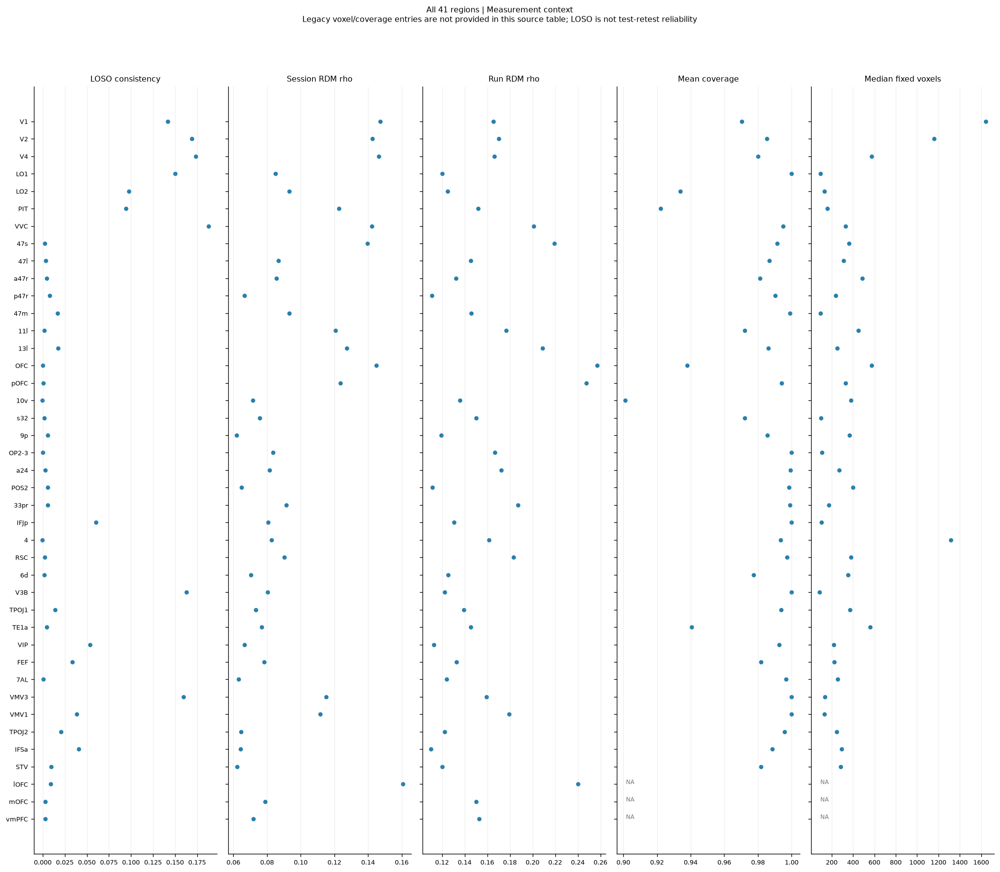

[全区域测量指标](ROI_quality_summary.csv)保留具体数值。原来的OFC−视觉差值与随机九区位置继续作为[既有补充描述](../20260918_控制实验报告_v02/结果报告.md#补充描述既有区域差值与随机分区参照)，不替代各区域自身的条件变化。

## 当前可陈述的结论与尚未完成的分析

现有描述性结果显示输入条件差异随营养、区域、提示和层而变化。蛋白质和脂肪在多个前额叶及随机区域有相对图片基线的正变化；视觉区域需分组及分营养解读。碳水和纤维包含净下降、相对错配下降较少、提示变号等不同模式。正确匹配T−P的分布与T−V、T−N并不相同，需逐区域报告。这里没有哪个区域必须胜出的成功标准。

N插入行中位11 token，营养行约15–18 token；本次控制未完全匹配长度、句法和数字格式。错配强度因营养而异，数据库营养值也不是参与者主观营养信念。样本是可用于共同错配的401图，不能自动外推到所有食品。

本报告补齐既有描述性结果的呈现，不新增显著性、等效性、置信区间、扫描结构敏感性或独立复制。它们原本后置，仍未执行；没有根据本轮正向区域或层段冻结新主效应。

## 数据来源、验证与文件入口

原v01/v02报告、冻结配置和原分数均保留。新增摘要从原数组导出，与原逐层绝对分数、逐人窗口值、均值／中位数／分位数和N/P范围核对；全部四项差值也从原V/T/N/P分数重构核验。新图只作绘制和汇总，不重算RSA。输入哈希、代码快照、依赖版本、显示参数及验证结论见[生成审计](generation_audit.json)和[完成核查](completion_receipt.json)。

- [全部区域并列表](全部区域并列摘要.md)、[原值CSV](parallel_region_summary.csv)
- [46套完整曲线索引](逐区域曲线索引.md)
- [完整一致性与个体附录](一致性与个体结果.md)
- [A/B一致性CSV](AB_consistency.csv)、[N/P逐套差值CSV](implementation_consistency.csv)、[个体分布摘要CSV](participant_summary.csv)
- [原逐人窗口数值](../20260918_控制RSA_v01/participant_window_summary.csv)
- [获批研究口径](../../docs/research/20260918_区域控制对照口径修订_v09_1.md)、[原冻结方案](../../docs/research/20260918_无关词与随机分区健壮性设计_v09.md)
- [原实验独立核查](../20260918_控制实验报告_v01/independent_validation.json)、[原实验完成回执](../20260918_控制实验报告_v01/completion_receipt.json)

